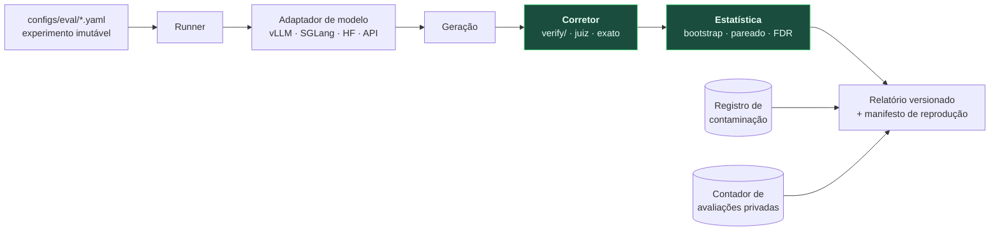

# DOC-12 — Harness de Avaliação e Protocolo Estatístico

**Projeto:** ΦFM — Phi Foundation Models para Física
**Status:** `RASCUNHO v0.1` — aguardando revisão do Stage-Gate 11
**Cobre:** entregável solicitado **11** (pipeline de avaliação); **encerra a Fase 3**
**Depende de:** [DOC-00 §6](../00-foundations/DOC-00-project-charter.md), [DOC-10](../02-models/DOC-10-raciocinio-verificacao-ferramentas.md), [DOC-11](DOC-11-physbench.md)
**Data:** 2026-08-03

---

## 1. A tese: o protocolo importa mais que os números

O DOC-11 define **o que** medir. Este define **como medir sem se enganar**.

A literatura de LLMs está cheia de comparações que não se sustentam: sementes únicas, ausência de intervalos de confiança, baselines convenientes, escolha post hoc da métrica que favorece, contaminação não reportada. Nada disso é fraude — é ausência de protocolo.

> Este programa faz alegações comparativas contra modelos publicados. **Uma alegação sem protocolo estatístico não é resultado, é anedota.** O DOC-00 §6 estabeleceu seis regras de integridade; este documento as torna executáveis e verificadas em CI.

---

## 2. Arquitetura do harness



Construído sobre o **lm-evaluation-harness** da EleutherAI, estendido com nossos corretores. Não reimplementamos infraestrutura de avaliação (P6) — estendemos a que a comunidade já audita.

**Requisito estrutural:** o corretor (`E`) é **o mesmo `verify/`** usado como recompensa de RLVR. É a imposição em código do princípio P3 e a razão de `eval.grading` importar de `verify` no DAG de módulos do DOC-01 §4.3.

---

## 3. Protocolo estatístico

### 3.1 O que é reportado, sempre

| Elemento | Obrigatório |
|---|---|
| Média pontual | ✅ |
| **IC bootstrap de 95%** sobre os itens (10.000 reamostragens) | ✅ |
| Número de itens `n` | ✅ |
| Número de sementes | ✅ ≥ 3 quando há amostragem |
| Versão do conjunto de teste | ✅ |
| Taxa de contaminação | ✅ |
| Taxa de `INCONCLUSIVE` | ✅ |
| Configuração de decodificação | ✅ |

**Um número sem intervalo de confiança não é publicado.** Nem em tabela interna, nem em slide, nem em paper.

### 3.2 Variabilidade: duas fontes distintas

| Fonte | Como capturar |
|---|---|
| **Variabilidade de item** — quais problemas caíram no conjunto | Bootstrap sobre itens |
| **Variabilidade de amostragem** — o modelo é estocástico | ≥ 3 sementes; reportar média e desvio |

São independentes e ambas precisam ser reportadas. Reportar só sementes esconde que o conjunto pode ser pequeno demais; reportar só bootstrap esconde que o modelo é instável.

**Decodificação:** temperatura 0 (`pass@1` determinístico) como número principal, mais `avg@8` com temperatura 0,7 para modelos de raciocínio, onde a variância importa. **A configuração é fixada antes de rodar**, nunca escolhida depois.

### 3.3 Comparações pareadas

Comparar dois modelos nos mesmos itens é um problema **pareado**, e tratá-lo como independente desperdiça poder estatístico e infla o `n` necessário.

| Tipo de métrica | Teste |
|---|---|
| Binária (certo/errado) | **McNemar** sobre pares discordantes |
| Contínua (escore de rubrica) | Bootstrap pareado da diferença |
| Ranqueamento (recuperação) | Wilcoxon pareado |

### 3.4 Múltiplas comparações

Dezesseis tarefas × vários modelos gera muitas hipóteses. Sem correção, **algo parecerá significativo por acaso** — com 16 tarefas e α = 0,05, a chance de ao menos um falso positivo é ~56%.

**Correção de Benjamini-Hochberg (FDR)** sobre a família de testes de cada alegação. Valores `p` brutos e corrigidos são ambos reportados.

### 3.5 Tamanho de efeito, não só significância

> Uma diferença de 0,3 ponto pode ser estatisticamente significativa com `n` grande e **irrelevante na prática**. Uma diferença de 8 pontos pode não atingir significância com `n` pequeno e ser **claramente real**.

Toda alegação reporta a **diferença absoluta com IC**, e o `p` corrigido é informação secundária. Diferenças com ICs sobrepostos são descritas como **não significativas**, nunca como vitória — regra 4 do DOC-00 §6.

### 3.6 Pré-registro

Mecanismo emprestado de ensaios clínicos, e o mais eficaz contra autoengano:

> **Antes de rodar qualquer avaliação de um marco, registrar em arquivo versionado:** quais tarefas são a manchete, qual o limiar de sucesso, quais baselines entram, e qual a hipótese. O commit precede a execução.

Isso impossibilita escolher post hoc a métrica que ficou boa. `configs/eval/preregistration/` guarda esses arquivos, e o relatório final aponta para o hash do pré-registro. Se uma métrica não pré-registrada for reportada, ela é rotulada **exploratória** — legítima, mas não confirmatória.

### 3.7 A regra do portão G2 — ACEITA em 2026-10-19

> **Estado: ACEITA pelo dono em 2026-10-19, como escrita.** Na mesma data, o dono decidiu não depender do GPQA: o G2.2 fica em 3 de 4. A regra foi escrita antes de medir as bases e antes de qualquer treino. Os parâmetros estão em [`configs/eval/preregistration/g2.yaml`](../../configs/eval/preregistration/g2.yaml). As travas estão em [`src/phifm/eval/g2.py`](../../src/phifm/eval/g2.py): `REGRA_G2_ACEITA = True` e `PROTOCOLO_G2_SHA256 = None`. Nenhum item de teste é tocado antes do hash do congelamento, que é gravado depois do dev e antes da primeira geração no teste. Aceitar a regra não autoriza treinar.

A regra cobre o G2.1, o G2.2 e o G2.3 do [DOC-00](../00-foundations/DOC-00-project-charter.md). O G2.4 (citação no modo RAG) e o G2.5 (calibração) precisam de regras próprias.

#### 3.7.1 Objeto

- **O que se compara.** O **ΦGen-CPT** é o checkpoint escolhido no dev, ainda um modelo base. Ele é comparado com **a própria base**, no mesmo protocolo, no mesmo motor e com o mesmo hash de configuração.
- **Dois portões independentes:** o ΦGen-1,7B contra a Qwen3-1.7B-Base e o ΦGen-8B contra a Qwen3-8B-Base. O "1,5B" do charter é a Qwen3-1.7B-Base.
- **Escopo do G2.2.** Pela nota de escopo do DOC-00, o G2.2 vale só para a 8B.
- **Pós-treino fica de fora.** Um ΦGen pós-treinado (SFT/RLVR) precisa de regra própria, com um braço de controle (a base com o mesmo pós-treino), escrita antes do T2b.

#### 3.7.2 Benchmarks e recortes

O **G2.1 decide** com 4 benchmarks abertos, 2.528 itens de teste:

| benchmark | recorte | teste | k |
|---|---|---|---|
| UGPhysics-en | resposta única de tipo limpo (NV, EX, EQ, MC, TF, IN), sem duplicata exata: 4.480 itens | 1.999 | 3 |
| OlympiadBench | `OE_TO_physics_en_COMP`, todos os itens, em 113 agrupamentos | 236 | 8 |
| PHYBench | `fullques_v1`, os 100 com gabarito | 100 | 16 |
| SciBench-física | class 56, fund 71, thermo 66 | 193 | 8 |

O **G2.3 decide** com três medidas:
- o MMLU sem as 4 matérias de física: 13.402 itens em 53 matérias;
- o EvalPlus, HumanEval+ 164 ∪ MBPP+ 378, num total de 542 problemas;
- o IFEval, com 541 prompts.

**Relatados, não decidem:**
- o MMLU de 57 matérias e o MMLU-física (640 itens);
- o HumanEval original, com as mesmas gerações do HumanEval+;
- a decodificação gulosa nos 529 itens de física;
- o IFEval cru;
- o GPQA-diamond-física, se o GPQA vier.

**Desenvolvimento, nunca relatado como resultado:**
- o UG-dev (≈899);
- o OlympiadBench `OE_TO_physics_zh_CEE` (115), como dev do extrator;
- os 34 `_sol` do SciBench;
- o MMLU dev (285) e o validation (1.531);
- o MBPP sem as tarefas do MBPP+.

**Fora de tudo:**
- `OE_MM_*` e `TP_*`;
- o UGPhysics-zh e os itens de várias respostas do UG;
- os 400 itens do PHYBench sem gabarito;
- o SciBench multimodal;
- JEEBench, TheoremQA e PhysReason.

**Sem GPQA.** O GPQA não entra no G2.1. O agregado fica fixado com os 4 abertos e não muda se o GPQA chegar.
- **No G2.2** vale o número do charter: ≥3 vitórias entre os 5 benchmarks listados, com o GPQA não medido contando como **não vencido**. Na prática isso exige 3 de 4. Não há substituto.
- **Se o dono aceitar os termos** do GPQA **antes** de a 8B-base ser medida, ele entra no G2.2 como 5º benchmark: recorte *main* com domínio Physics (187 itens), 5-shot CoT com exemplos de Química e Biologia, k=8.
- **Se chegar depois** da medida da 8B-base, ele fica só relatado.

#### 3.7.3 Partição dev/teste, lacre e acessos

**Princípio.** Tudo o que se escolhe é escolhido em material que nunca é teste: prompt, exemplos, extrator, corretor, teto de fichas, LR e checkpoint. Depois, tudo é congelado por hash.

**UGPhysics, partição por grupos.**
- **O que é um grupo.** É um componente conexo de itens que compartilham ≥1 13-grama de palavras do enunciado. Só contam os 13-gramas presentes em 2 a 50 itens.
- **A matéria do grupo** é a do item de menor índice.
- **O sorteio**, com a semente 20261019:
  - 20% dos grupos de cada matéria vão para o **DEV**;
  - dos grupos restantes, ≈2.000 itens elegíveis vão para o **TESTE**, em proporção à matéria e sorteados por grupo;
  - o resto é a **RESERVA LACRADA**.
- **Nenhum grupo é dividido.** O código é `g2.particionar_por_grupos`.
- **Contagens e destino.** Gravada em 2026-10-19, antes de qualquer saída de modelo: dev 899, teste 1.999 e reserva 1.582, em 3.948 grupos; a subamostra do G2.2 tem 1.004 itens (sha256 `3198479e…` no `g2.yaml`). As listas de ids vão para `data/processed/avaliacao/g2_particao.json`, com hash, **no git antes de qualquer saída de modelo**.

**Os outros três ficam 100% no teste.** O dev de formato vem do OlympiadBench-zh e dos `_sol` do SciBench.

**Desenvolvimento sem olhar o teste:**
1. **Autoteste do gabarito**, automático e sem modelo. Cada gabarito, posto em `\boxed{}`, tem de dar PASS contra si mesmo. O gabarito perturbado tem de dar FAIL:
   - o numérico é deslocado por 3× a tolerância do próprio item;
   - o simbólico recebe um símbolo trocado e um +1.

   O item que falha sai dos dois braços, por id. A string de um gabarito que falhou só é olhada com o aval do dono.
2. **Extrator e corretor**, desenvolvidos com a 1,7B-base no dev (k=1), em no máximo 5 iterações. Alvos: ≤5% sem resposta e ≤3% truncado.
3. **Auditoria do corretor**, feita pelo Claude às cegas em 200 gerações do dev, com o hash dos veredictos gravado antes. Alvo: concordância ≥95% e κ ≥0,8. Se não chegar lá em 5 iterações, a medida para e o dono decide por emenda.
4. **Sanidade das outras medidas:**
   - o MMLU é validado no dev;
   - as soluções canônicas do código passam 100% e as quebradas falham;
   - o envelope do IFEval é testado em 20 instruções escritas fora do IFEval.

**Lacre.**
- **As gerações de teste** são gravadas com sha256.
- **Até o veredito do ΦGen** só se leem agregados e contadores automáticos (sem resposta, truncado, INCONCLUSIVE). Nada se lê por item.
- **Um defeito do corretor achado depois** é corrigido no dev, reaplicado às saídas gravadas **dos dois braços** e registrado como desvio.

**Livro de acessos**, em `data/processed/avaliacao/g2_acessos.jsonl`, conferido por `g2.registrar_acesso`:
- **Por tamanho:** 1 acesso para a base e 1 para o ΦGen.
- **Repetição:** 1 só, por falha operacional, com a parcial descartada e registrada.
- **A base é re-medida** se o hash da configuração mudar. Ela só vale no veredito com o **mesmo** hash do ΦGen.
- **Cada comparador do G2.2** tem 1 acesso.
- **A reserva do UG** só abre por emenda escrita.

#### 3.7.4 Protocolo de geração

**Física**
- **Formato.** Modelo base, texto corrido, sem template de chat. Cabeçalho fixo e exemplos no formato `Problem / Solution`, cada solução terminando em `The final answer is $\boxed{…}$`.
- **Decodificação.** T=0,6, top-p 0,95, sem top-k, sem min-p e sem penalidades. A semente da amostra j é `sha256('bench:id:j')`, a mesma nos dois braços. Máximo de 4.096 fichas.
- **Paradas:** `\n\nProblem:`, `\nProblem:`, `<|endoftext|>` e `<|im_end|>`.
- **Guarda de repetição** no cliente: uma janela de 32 fichas que aparece 4 vezes corta a geração, igual nos dois braços.
- **Extração.** O último `\boxed{}` de chaves balanceadas. Se não houver, o que vem depois de `final answer is`. Se não houver, a resposta é "sem resposta".
- **Nota.** A do item é a média das k amostras (avg@k). FAIL, sem resposta, truncado, INCONCLUSIVE e ERROR valem 0. A do benchmark é a média dos itens ×100.

**Exemplos few-shot**, fixos e sorteados com a semente; nenhum pode ser irmão (13-grama) de um item de teste:

| benchmark | exemplos |
|---|---|
| UGPhysics | 4 do UG-dev, de 4 matérias diferentes |
| OlympiadBench | 4 do UG-dev |
| PHYBench | 3 EX do UG-dev |
| SciBench | 3 `_sol` do próprio livro, sem os quase-duplicados de itens de teste (saem 3 no thermo) |

**Correção.** É um adaptador novo sobre `verify/`, com um comparador numérico com tolerância, que hoje falta.

| benchmark | critério |
|---|---|
| UGPhysics NV | valor completo com erro relativo ≤1e-2. Desvio declarado: o oficial compara só a mantissa, e esse critério fica relatado |
| OlympiadBench | \|Δ\| ≤ `error` (absoluto); o único item sem `error` usa 1e-2 relativo. Sem o atalho oficial de percentagem |
| PHYBench | equivalência simbólica, com variáveis positivas |
| SciBench | `math.isclose(rel_tol=0,05)`, com a escala 10^x da unidade convertida |

Cada comparação tem limite de 10 s. Estourar o limite dá INCONCLUSIVE.

**Correções de dev do corretor, registradas antes do congelamento (2026-10-19).** O autoteste do gabarito no UG-dev excluía **17,9%** dos itens, contra o limite de 5%. A regra manda consertar o parser no dev, e foi o que se fez, olhando só gabaritos de dev. Tudo vale igual nos dois braços e entra no hash do congelamento (`g2_corretor.py`, `g2_itens.py`). As correções:

1. **Tipo efetivo pela forma do gabarito no UGPhysics.** O rótulo do dataset erra:
   - 105 dos 396 itens "NV" do dev têm gabarito simbólico, que passa a ser corrigido como EX;
   - EQ do tipo `símbolo = número` vira NV pelo lado direito, e EQ sem `=` vira EX;
   - EQ com várias equações separadas por vírgula vira várias respostas;
   - IN escrito como desigualdade é comparado como desigualdade (mesma estrição e f_resp/f_gab constante positiva).

   A linha de resposta do prompt segue o tipo efetivo.
2. **Gabarito com cálculo** (integral, soma, produtório, ∂, limite, ∇, bra-ket, diferencial explícito, barra de avaliação) **não é verificável por regra**. O parser devolve uma expressão sem o significado, por exemplo ∂S/∂p de um símbolo vira 0. O comparador devolve INCONCLUSIVE, e o autoteste exclui o item dos dois braços. Prefere-se excluir a aprovar por coincidência de lixo.
3. **Gabarito que o parser não lê** (termo espectral `{}^{3}P_{0}`) é comparado como texto normalizado.
4. **Camada de Física sobre o `parse` do verify:**
   - `\pi` vira π, porque o parser o devolvia como símbolo;
   - `e^{x}` simbólico vira exp;
   - `\mu (…)` deixa de ser lido como função;
   - `I` é símbolo, não a unidade imaginária;
   - `\dot{x}` vira um identificador próprio, para que x e ẋ não colapsem;
   - `\langle E\rangle` simples vira identificador;
   - `\operatorname{coth}` vira `\coth`;
   - módulo |X| vira √(X²), porque o `parse` do verify **descartava `\left|E\right|` em silêncio**;
   - `d` antes de comando deixa de ser lido como diferencial;
   - linha e estrela viram subscrito nomeado;
   - `\{ \}` viram parênteses;
   - graus e minutos de arco viram número.
5. **Aquecimento do parser.** A primeira chamada ao parser LaTeX passava do teto de 5 s do verify no Windows, e a primeira resposta saía INCONCLUSIVE. O corretor agora aquece o parser na importação.

Os defeitos do item 4 que estão no próprio `verify/` (módulo, π, carga a frio) ficam para uma correção lá, porque o verify também é a recompensa do RLVR.

**MMLU.** 5-shot com os 5 itens de dev da matéria, uma chamada por item.
- **Previsão.** A maior probabilidade entre as fichas ` A`, ` B`, ` C` e ` D`, a temperatura 0.
- **Guarda do instrumento.** O MMLU de 57 matérias da base tem de ficar a ±3 pontos de 62,63 (1,7B) e de 76,89 (8B). Fora disso, a medida para, e só se corrige bug.

**Código (EvalPlus).**
- **Geração.** Prompts oficiais para completação direta, 0-shot, k=10 a T=0,2, mais 1 gulosa. As paradas e o sanitizador são os do EvalPlus, por conjunto.
- **Acerto.** Passar em todos os testes *plus*.
- **Execução.** Num notebook de **CPU do Kaggle com a internet desligada** e sem segredos, que é uma exceção registrada ao DOC-10 §3.6. Nunca no Windows.
- **Sanidade.** A média gulosa da base fica a ±5 de 52,70 (1,7B) e de 67,65 (8B).

**IFEval.**
- **Envelope.** Texto corrido, sem fichas especiais: um preâmbulo curto e 3 demonstrações `# Query / # Answer` sem restrições verificáveis. O envelope é escrito uma vez e congelado por hash.
- **Geração.** k=16 a T=0,7, top-p 0,8 e top-k 20, mais 1 gulosa, com até 1.280 fichas.
- **Correção.** Pelo código oficial.
- **O que decide** é o *prompt-level strict* médio das amostras. O IFEval cru e guloso, como o Open LLM Leaderboard roda bases, é relatado.
- **Por que o envelope.** O template de chat mediria a familiaridade com `<|im_start|>`, que a base tem e o CPT apaga. O IFEval cru mede o hábito de emitir EOS.

#### 3.7.5 Motor e precisão

- **O motor.** É o llama.cpp `llama-server` na tag **b11159** (commit 6b790a9c2).
- **A conversão.** GGUF **Q8_0** estático, convertido por nós a partir dos safetensors da revisão fixada, com o `convert_hf_to_gguf.py` da mesma tag e sem imatrix. Nenhum GGUF de terceiros.
- **Onde roda.** O par 1,7B roda na RX 7600 local (Vulkan). O par 8B roda no Kaggle 2×T4 (CUDA, mesmo commit).
- **O hash da configuração.** Reúne commit, flags, sha256 do GGUF, GPU e imagem. Vai em todo resultado.
- **Antes do teste.** A KL média do Q8_0 contra o F16 em 50 prompts do dev tem de ficar ≤0,01 nats.
- **Tokenizer.** O do ΦGen tem de ser idêntico ao da base (sha256 `c0382117…`). Se mudar, a regra não se aplica.

#### 3.7.6 G2.1 — a regra

- **Os deltas.** Δ_b = acerto_ΦGen − acerto_base em cada benchmark (avg@k ×100). **Δ_macro** é a média simples dos 4 Δ_b, com peso 1/4 cada; a micro daria ~79% do peso ao UG.
- **O IC.** IC 95% por **bootstrap pareado, estratificado por benchmark**, reamostrando agrupamentos (os grupos de 13-grama no UG, os 113 do Oly, os itens no PHYBench e no SciBench). São 10.000 réplicas com a semente 20261019.
- **Desvio declarado.** Este IC da diferença pareada substitui o critério de "ICs sobrepostos" do §3.5.

**O G2.1 PASSA só com as três condições:**
1. o limite de baixo do IC 95% de Δ_macro é **≥ +10,0**;
2. nenhum dos quatro Δ_b tem o IC **inteiro abaixo de 0**;
3. sem os itens de **memorização nova** (sinal S1 ou S2 no ΦGen e não na base, ver §3.7.9), o limite de baixo continua ≥ +10,0.

Fora disso, NÃO PASSA. A leitura é "demonstrado abaixo" se o IC fica inteiro abaixo de +10, ou "não demonstrado" se o IC atravessa +10. Se mais da metade do ganho vier de itens em que a base não tinha resposta extraível, a publicação diz **"ganho de formato"**.

**Poder**, por simulação com premissas não medidas, que serão recalculadas com a base medida sem mudar a regra:
- o erro-padrão do macro fica entre 0,72 e 0,92 ponto;
- a regra passa com 80% de chance a partir de +12,0 a +12,6 de ganho verdadeiro, e em 2,5% das vezes com +10 exato;
- com decodificação gulosa, o erro-padrão seria 1,57–1,83 ponto.

#### 3.7.7 G2.3 — a regra

Δ = ΦGen − base, em pontos, com IC 95% por bootstrap pareado sobre os itens:

| medida | regra |
|---|---|
| MMLU sem física (13.402) | **não-inferioridade demonstrada**: passa só se o limite de baixo ≥ −2,0 |
| EvalPlus (542), pass@1 = média de c/10 | **desclassifica** se Δ̂ < −2,0 **e** o IC inteiro abaixo de 0 |
| IFEval no envelope (541), strict médio de 16 | **desclassifica** se Δ̂ < −2,0 **e** o IC inteiro abaixo de 0 |

- **Uma basta.** Uma medida que falhe desclassifica sozinha (DOC-19 R-3), e por isso não há correção de multiplicidade.
- **A assimetria é declarada.** A não-inferioridade nas três reprovaria entre 15% e 50% dos ΦGen sem regressão nenhuma. Por simulação:
  - a forma escolhida desclassifica um ΦGen sem regressão em 0,3–1,4% das vezes por medida;
  - ela pega uma regressão verdadeira de −3 em 87–92%;
  - uma de −2 passa metade das vezes.
- **Durante o treino**, a "regressão geral < 2" do DOC-08 §5.3 é medida só no dev (MMLU validation e MBPP fora do MBPP+).

#### 3.7.8 G2.2 — a regra (só na 8B)

**Forma restrita.** O ΦGen-8B é comparado com **bases abertas ≤32B no mesmo protocolo de base**.
- **Números publicados** nunca são comparador: vêm de outros protocolos e servem só de contexto.
- **Comparadores**, lista fechada, Apache-2.0 e sem termos a aceitar:
  - **Qwen3-14B-Base**;
  - **Qwen3-30B-A3B-Base**;
  - **Qwen2.5-32B**.

  Um modelo *gated* só entra se o dono aceitar os termos antes de medir o ΦGen-8B.
- **Modelos instruídos e de raciocínio** ≤32B **não são medidos**, e isso é declarado.

**Itens.** A subamostra fixa de 1.004 do UG-teste (`teste_g2_2`) e os testes inteiros dos outros três. Os comparadores rodam com k=1 no UG, 2 no Oly e no Sci, e 4 no PHY. O ΦGen reaproveita as próprias saídas do G2.1.

**A regra.**
- **Vitória por benchmark.** O ΦGen vence o benchmark b se, contra **cada** comparador, o **IC 99%** da diferença pareada fica inteiro acima de 0. O 99% é Bonferroni sobre os 5 benchmarks.
- **Comparador quantizado.** Contra um comparador medido abaixo de Q8_0, o IC tem de ficar acima de +1,0.
- **Aprovação.** O G2.2 **passa com ≥3 vitórias entre os 5**.
- **Custo estimado:** ~20 h de Kaggle, só depois de existir o ΦGen-8B congelado.

#### 3.7.9 Contaminação

**(A) A base não é descontaminável.** O G2.1 é um delta, e a contaminação herdada se cancela se o CPT não a ampliar. Duas sondas gulosas, sem exemplos, rodam nos 2.528 itens de física:
- **S1:** o modelo recebe a primeira metade do enunciado e gera 48 fichas;
- **S2:** o modelo recebe o enunciado e 40% da solução e gera 64 fichas.

O item é suspeito se houver ≥1 sequência de 13 fichas idêntica à verdadeira. O PHYBench, publicado depois dos dados da base, é o nulo. A lista de ids suspeitos é lacrada antes do treino.

**(B) O corpus do CPT — PRÉ-CONDIÇÃO.** Sem ela, o ΦGen não é medido. O corpus final é varrido contra **todos** os itens do G2 (dev, teste, reserva e exemplos). Sai o documento que:
- tiver ≥1 13-grama de palavras de um enunciado ou de uma solução. Frase-feita é o 13-grama presente em ≥3 itens de benchmark ou em >1.000 documentos;
- contiver a forma canônica de um gabarito com ≥8 fichas.

O vetor semântico só é relatado. As remoções são publicadas por benchmark.

**(C) Depois do treino.** As sondas S1 e S2 são refeitas no ΦGen. Item com sinal no ΦGen e sem sinal na base é **memorização nova**, e alimenta a condição 3 do G2.1.

#### 3.7.10 Limites declarados

- **Pessoas.** Não há físicos nem revisão humana. O corretor é por regras, auditado pelo Claude no dev. O §6 deste documento e o DOC-00 §6.6 não são cumpridos, e nada se alega além das métricas medidas.
- **Recortes dos benchmarks.**
  - UGPhysics: sem o juiz GPT-4o, só itens de resposta única, 1.999 dos 5.520.
  - PHYBench: 100 dos 500.
  - OlympiadBench: só o recorte de texto em inglês.
  - SciBench: 193 itens.

  Nenhum desses números se compara aos artigos.
- **Tamanho e privacidade do teste.**
  - Não há teste privado (§7); a partição, o lacre, o contador e a reserva fazem as vezes dele.
  - O DOC-11 §8.2 (≥1.000 itens por tarefa) não é cumprido por Oly, PHY e Sci isolados; o agregado tem 2.528 itens.
- **Desvios do protocolo do §3:**
  - Q8_0 em vez de BF16;
  - avg@k a T=0,6 como métrica principal, no lugar do pass@1 guloso do §3.2;
  - INCONCLUSIVE conta como erro, desvio do §4.1;
  - o IFEval roda num envelope do projeto.
- **G2.3 e G2.2.** O G2.3 é assimétrico. O G2.2 fica restrito a 3 bases abertas e, sem GPQA, vira 3 de 4.
- **Portão anterior.** O G1 não foi vencido (G1.3 impossível pelo ADR-0003, G1.4 adiado, G1.5 parcial). O Tier 2 não começa sem um ADR que o autorize ou que revise o G1.
- **Riscos maiores:**
  - o corretor é código novo e é o elo fraco;
  - a vazão não foi medida;
  - a 1,7B pode ficar no piso no PHYBench;
  - o agrupamento por 13-grama não pega irmãos parafraseados;
  - é provável que o G2.2 falhe contra o Qwen3-30B-A3B-Base e o Qwen2.5-32B, e o negativo é publicado.

#### 3.7.11 Verificar antes de congelar

1. **Vazão** (`llama-batched-bench`, local e no Kaggle). Abaixo da metade da suposta, o dono decide os cortes antes da base: primeiro o IFEval de k=16 para k=8, depois o UG de k=3 para k=1.
2. **Memória da RX 7600** com `-np 4` × 10.240 e KV q8_0, e flash attention com KV q8_0 nos dois builds.
3. **MMLU.** O argmax das 4 letras pelo `n_probs` do servidor tem de bater com o do transformers na CPU em ~50 itens do dev.
4. **KL** do Q8_0 contra o F16 ≤0,01 nats.
5. **Autoteste do gabarito.** Exclusão ≤5% por benchmark; acima disso, conserta-se o parser.
6. **Extrator e auditoria no dev**, com os alvos do §3.7.3, e as fichas médias medidas contra as premissas.
7. **Troca.** A taxa de troca em 200 itens do dev rodados duas vezes.
8. **Sanidade da 8B-base** em 300 itens do UG-dev, antes do teste.
9. **Código e IFEval:**
   - a sobreposição MBPP × MBPP+ por `task_id`;
   - as canônicas do EvalPlus no notebook sem internet;
   - o envelope em 20 instruções de fora.
10. **Partição e exemplos.** A partição e os exemplos são gravados com hash. Nenhum exemplo pode ser irmão de item de teste.
11. **Kaggle:**
    - o 2×T4 consome a cota como uma sessão só;
    - a sessão de 12 h em segundo plano retoma por item;
    - o binário guardado como dataset roda sem recompilar.

---

## 4. Correção

### 4.1 Verificável

Delegada ao `verify/` (DOC-10). Três regras:

1. **Equivalência de CAS, nunca casamento de string** (DOC-11 §4).
2. **`INCONCLUSIVE` sai do denominador** e é reportado separadamente — jamais contado como erro do modelo.
3. **Verificador reservado** (DOC-09 §5.4) roda em paralelo; divergência entre ele e o de treino é alerta de reward hacking.

### 4.2 Por juiz LLM

Só para o que não é verificável (`PB-Concept`, qualidade de explicação).

| Regra | Valor |
|---|---|
| Juízes | ≥ 3 modelos distintos |
| Rubrica | Explícita, com âncoras, escrita por física |
| Ordem | Randomizada; posições embaralhadas contra viés de posição |
| Cegamento | O juiz não sabe qual modelo produziu qual resposta |
| **Auto-preferência** | ★ **O ΦGen nunca julga a si mesmo, nem a outro ΦGen** |
| Calibração | Concordância com físicos humanos medida em 200 itens e **publicada** |

O viés de auto-preferência é documentado e forte: modelos preferem o próprio estilo. Usar o ΦGen como juiz do ΦGen inflaria os resultados de forma invisível.

---

## 5. Descontaminação e o relatório que a acompanha

Executada pelos três vetores do DOC-04 §6.2 — n-grama, embedding e **forma canônica de equação** — antes de qualquer alegação.

**O relatório de contaminação é publicado junto com os resultados**, contendo por benchmark: taxa de contaminação, número de itens removidos, e resultados **com e sem** os itens contaminados. Se a diferença entre as duas versões for grande, isso é a informação mais importante da tabela.

**A limitação herdada permanece declarada:** não é possível descontaminar o Qwen3-8B-Base. Por isso o critério **G2.1** — delta contra o próprio modelo base — é a métrica de manchete (DOC-04 §6.4).

---

## 6. Avaliação humana

O critério 6 do DOC-00 §6 exige físico no laço para qualquer alegação de capacidade.

| Elemento | Especificação |
|---|---|
| Amostra | 300 respostas, estratificadas por tarefa e subárea |
| Avaliadores | ≥ 3 físicos, com pelo menos um experimental |
| Cegamento | Duplo — avaliador não sabe o modelo; a ordem é randomizada |
| Instrumento | Rubrica com âncoras + campo livre para erros de Física |
| Concordância | **Alpha de Krippendorff** reportado; abaixo de 0,6 invalida a rodada |
| Portão | Nenhuma alegação de capacidade em Física é publicada sem esta etapa |

O campo livre é o mais valioso: erros que nenhuma métrica automática captura — uma hipótese física implícita e falsa, um raciocínio circular, uma resposta certa por motivo errado.

---

## 7. Avaliação durante o treino vs. avaliação final

| | Durante o treino | Final |
|---|---|---|
| Conjunto | **Público de dev** | **Privado de teste** |
| Frequência | A cada 1.000–5.000 passos | Em marcos |
| Custo | Subconjunto barato | Suíte completa |
| Uso | Diagnóstico, ajuste de mistura | **Alegações** |
| Contabilizado no contador do DOC-11 §8.3 | Não | **Sim** |

**Nunca ajustar hiperparâmetros olhando o conjunto privado.** Fazê-lo o converte em conjunto de validação e destrói sua função — silenciosamente, porque nenhum item vazou.

---

## 8. Reprodutibilidade de um resultado

Todo relatório carrega um **manifesto de reprodução**:

```yaml
result_id: blake3:9f2a...
preregistration: blake3:3c81...      # o pré-registro que precedeu a execução
model:      phifm-gen-1p5b-rlvr-a3f21c04-9b7e0d12-012000
code:       git 7a8c85b
harness:    lm-eval-harness 0.4.x + phifm.eval 0.1.0
benchmark:  PhysBench-v2026.2 (privado)
decoding:   {temperature: 0.0, max_tokens: 4096}
seeds:      [17, 42, 1337]
verifier:   phifm.verify 0.3.1
hardware:   1x H100 80GB SXM
command:    make eval EXPERIMENT=...
```

Um terceiro reproduz ou refuta a partir disso — princípio **P7** do DOC-01. O `verifier` versionado é essencial: uma mudança no barramento pode alterar escores, e resultados antigos nunca são silenciosamente reinterpretados (DOC-10 §10).

---

## 9. O formato padrão de relatório

Toda tabela publicada segue este formato. Exemplo ilustrativo:

| Modelo | PB-Verify | PB-Dim | GPQA-física | MMLU (regressão) |
|---|---|---|---|---|
| Qwen3-8B-Base *(baseline)* | 31,2 ±3,0 | 48,7 ±3,1 | 39,4 ±3,4 | 71,2 ±1,1 |
| **ΦGen-8B** | **52,8 ±3,2** | **74,1 ±2,7** | **48,9 ±3,4** | 70,6 ±1,1 |
| **Δ vs. base** | **+21,6** [17,2; 26,0] | **+25,4** [21,1; 29,7] | **+9,5** [4,8; 14,2] | **−0,6** [−1,9; +0,7] |
| Modelo geral forte ≤32B | 44,1 ±3,2 | 61,3 ±3,0 | 51,2 ±3,4 | 76,8 ±1,0 |

Quatro coisas que este formato força:

1. **A linha de delta contra a base é a manchete** — G2.1.
2. **A coluna de regressão está sempre visível** — G2.3 não pode ser esquecido.
3. **O baseline geral forte aparece**, mesmo quando nos vence (aqui vence em GPQA e MMLU) — regra 3 do DOC-00 §6.
4. **Todo número tem incerteza.**

> Note o exemplo: o modelo geral vence em GPQA-física. **Reportar isso é obrigatório.** Uma tabela em que o nosso modelo vence em tudo seria sinal de que os baselines foram escolhidos a dedo.

---

## 10. Custo

| Item | Custo |
|---|---|
| Execução da suíte completa (1 modelo) | ~US$ 8 |
| Baselines (5 modelos × suíte) | ~US$ 40 |
| Juízes LLM (calibração + `PB-Concept`) | ~US$ 25 |
| Avaliação contínua durante treinos | ~US$ 25 |
| **Total em computação** | **~US$ 100** |
| Avaliação humana | Tempo de especialista |

---

## 11. Riscos

| Risco | Prob. | Impacto | Mitigação |
|---|---|---|---|
| Escolha post hoc da métrica favorável | **Alta** | **Crítico para credibilidade** | Pré-registro versionado (§3.6) |
| Conjunto privado vira validação por uso repetido | Média | **Alto** | Contador publicado; §7 |
| Baselines fracos inflam nossos resultados | Média | **Alto** | Modelo geral forte obrigatório na tabela (§9) |
| Juiz LLM com viés de auto-preferência | **Alta** | Alto | ΦGen nunca julga ΦGen (§4.2) |
| Concordância humana baixa invalida `PB-Concept` | **Alta** | Médio | Krippendorff < 0,6 invalida a rodada; reportado como fraco |
| Bug no verificador afeta treino e avaliação juntos | Média | **Crítico** | Verificador reservado; DOC-10 §12 |

---

## 12. Critérios de aceite do Stage-Gate 11

- [ ] **L1** — Nenhum número publicado sem IC, `n`, sementes e versão do conjunto
- [ ] **L2** — Pré-registro implementado; CI rejeita relatório sem hash de pré-registro
- [ ] **L3** — Testes pareados e correção FDR implementados e usados
- [ ] **L4** — Corretor é literalmente `verify/`; verificado por teste de importação
- [ ] **L5** — Relatório de contaminação gerado automaticamente com todo resultado
- [ ] **L6** — Protocolo de avaliação humana executado, com Krippendorff ≥ 0,6
- [ ] **L7** — Manifesto de reprodução emitido para todo resultado; reprodução verificada por terceiro
- [ ] **L8** — Contador de avaliações contra o conjunto privado ativo e publicado
- [ ] **L9** — Tabela padrão inclui baseline geral forte, mesmo quando ele vence

---

## 13. Questões em aberto

| ID | Questão | Destino |
|---|---|---|
| OQ-47 | `avg@8` ou `pass@1` como métrica principal para modelos de raciocínio? | Fixar antes do primeiro pré-registro |
| OQ-48 | Krippendorff ≥ 0,6 é limiar adequado para julgamento de Física? | Calibrar com a primeira rodada humana |
| OQ-49 | Publicar um leaderboard público exigiria infraestrutura de submissão? | DOC-18 — decisão de release |

---

## 14. Referências

1. Dietterich, T. (1998). *Approximate Statistical Tests for Comparing Supervised Classification Learning Algorithms.* Neural Computation.
2. Benjamini, Y., Hochberg, Y. (1995). *Controlling the False Discovery Rate.* JRSS-B.
3. Efron, B., Tibshirani, R. (1994). *An Introduction to the Bootstrap.* Chapman & Hall.
4. Dwork, C. et al. (2015). *The reusable holdout.* Science 349.
5. Krippendorff, K. (2004). *Content Analysis: An Introduction to Its Methodology.*
6. Zheng, L. et al. (2023). *Judging LLM-as-a-Judge.* NeurIPS.
7. Panickssery, A. et al. (2024). *LLM Evaluators Recognize and Favor Their Own Generations.* NeurIPS.
8. Gao, L. et al. (2023). *A framework for few-shot language model evaluation* (lm-evaluation-harness).

---

**Fim do DOC-12.** Encerra a Fase 3.
