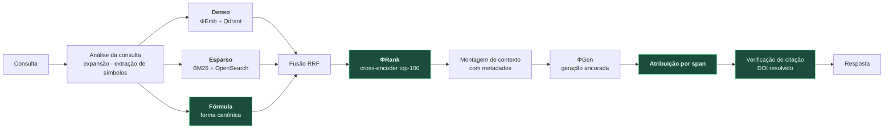

# DOC-13 — Recuperação, Embeddings e Stack de RAG

**Projeto:** ΦFM — Phi Foundation Models para Física
**Status:** `RASCUNHO v0.1` — aguardando revisão do Stage-Gate 12
**Cobre:** entregáveis solicitados **17** (RAG) e **18** (embeddings); abre a **Fase 4**
**Depende de:** [DOC-07 §3, §4](../02-models/DOC-07-familia-de-modelos.md), [DOC-11 §6](../03-evaluation/DOC-11-physbench.md)
**Data:** 2026-08-03

---

## 1. Por que RAG em Física não é RAG genérico

Três diferenças que invalidam a receita padrão:

| Diferença | Consequência |
|---|---|
| **Símbolos raros carregam a consulta** | `SU(3)`, `Λ`CDM, `ATLAS`, `Δm²₃₁` — recuperação densa é notoriamente fraca em tokens raros. Busca híbrida não é otimização, é requisito |
| **A unidade de sentido não é o parágrafo** | Uma equação sem seu contexto é ruído; uma derivação partida ao meio é pior que ausente. Chunking ingênuo destrói o conteúdo mais valioso |
| **Citação errada é falha catastrófica** | O DOC-00 §2 (F6) e o destino do Galactica. Precisão de citação é **portão**, não métrica |

E uma vantagem: o corpus é **nosso**, com proveniência, licença, taxonomia e equações canonicalizadas já no schema (DOC-01 §6). Um sistema de RAG genérico opera sobre texto opaco; o nosso opera sobre documentos estruturados.

---

## 2. Arquitetura



---

## 3. Chunking: onde a maioria dos sistemas erra

Chunking por número fixo de tokens é o padrão da indústria e é **destrutivo em Física**.

**Regras de fronteira, em ordem de precedência:**

| # | Regra |
|---|---|
| 1 | **Nunca partir uma equação** — nem um ambiente `align`/`equation` |
| 2 | **Nunca separar uma equação do seu contexto** — `context_before`/`context_after` do DOC-03 §2.5 acompanham |
| 3 | Preferir fronteiras de seção e subseção |
| 4 | Manter tabelas e legendas de figura íntegras |
| 5 | Só então respeitar o tamanho-alvo (~512 tokens, com sobreposição de 64) |

**Chunking hierárquico:** indexar em três granularidades — documento, seção e trecho — e recuperar no nível que a consulta pedir. Uma pergunta conceitual quer a seção; uma busca por fórmula quer o trecho; "que papers tratam disso" quer o documento.

Cada chunk carrega, herdado do `PhysicsDocumentRecord`: `doc_id`, seção, subárea, tipo de documento, nível, ano, **licença** e as equações canonicalizadas que contém.

### 3.1 O cortador que existe (2026-10-09)

`phifm.retrieval.trechos.cortar` — escrito para o piloto dos trechos
([PLANO](PLANO-trechos-do-texto-completo.md), etapa 0), sobre o LaTeX do RedPajama.
Cumpre as regras 1 a 3; nas outras duas, **desvia, e o desvio é declarado**:

| regra | o que o cortador faz |
|---|---|
| 1 · equação | bloco indivisível: `equation`, `align`, `eqnarray`, `gather`, `multline`…, `\[…\]`, `$$…$$`. Maior que o trecho, sai inteira e marcada (`excede`), e o encoder trunca — 4,5% dos trechos |
| 2 · contexto | a equação é empacotada com o parágrafo que a antecede; sem caber, o trecho novo abre com a última frase do anterior |
| 3 · seção | nenhum trecho atravessa `\section` / `\subsection`; a subseção herda o tipo da seção (introdução · conclusão · corpo) |
| 4 · tabelas | ⚠️ **desvio:** da tabela e da figura fica só a **legenda**. As células são números soltos para um encoder de 192 tokens, e a tabela média não cabe num trecho. Um valor que só existe numa célula não é recuperável |
| 5 · tamanho | ⚠️ **desvio:** ~160 tokens de texto, e não 512. O encoder do sistema lê 192, e cada trecho vai com o título do artigo na frente (`título. trecho`, o formato do treino) |

Antes de cortar, saem comentários, bibliografia, `\cite`/`\ref`/`\label`, a casca de
formatação e os agradecimentos. O RedPajama corta o preâmbulo, então os atalhos de autor
(`\be … \ee`) chegam sem definição: são devolvidos ao ambiente **só com prova no próprio
documento** (abrem e fecham intercalados), porque `\ba` também é "a em negrito".

**A auditoria M1** (`scripts/piloto_trechos.py --auditar`, agregado em
`data/processed/avaliacao/trechos_auditoria_m1.json`): 10.000 trechos sorteados de 320
artigos de 8 partes do corpus.

| | |
|---|---|
| trechos com equação aberta ou fechada sem par | **11 de 10.000** |
| …em artigo íntegro — o que a M1 cobra do cortador | **0** |
| …em artigo que **já chega** com equação sem par | **11**, de 5 artigos (1,9% dos 320) |

Os 5 artigos abrem equação com macro própria (`\eq{um} … \end{equation}`) ou perderam
caracteres no RedPajama (o removedor de comentários dele comeu o caractere antes de cada
`%`: `\begin{align}%` chegou como `\begin{align`). O cortador repara o que tem prova e
não adivinha o resto. **A caixa da M1 (§11) fica aberta:** "zero em 10.000" não foi
atingido no número bruto, e decidir se o dano de origem conta é do dono.

---

## 4. Busca híbrida

### 4.1 As três pernas

| Perna | Motor | Boa em | Fraca em |
|---|---|---|---|
| **Densa** | ΦEmb + Qdrant | Similaridade semântica, paráfrase | Símbolos raros, casamento exato |
| **Esparsa** | BM25 (OpenSearch) | Termos raros, nomes próprios, siglas | Sinônimos, reformulação |
| **Fórmula** ★ | Índice de `canonical_latex` | **Recuperação por equação** | Só serve a consultas com fórmula |

A terceira perna é específica do domínio e só é possível porque o DOC-03 §3 produziu a forma canônica. É o que responde *"que papers usam esta equação?"* sob variação notacional.

> ⚠️ **Medido em 2026-09-18, e aceito em 2026-09-23 ([DOC-11 §6.3](../03-evaluation/DOC-11-physbench.md)):** a perna densa **não** é fraca em casamento de equação neste corpus. No PB-Formula, estrato que exige variação notacional, o ΦEmb do sistema faz recall@1 **0,8595** contra **0,7115** do BM25 sobre a equação inteira, e a vantagem cresce com a variação. A coluna "fraca em" da perna densa descreve a expectativa da literatura, não a medida daqui.
>
> A perna de fórmula, portanto, **não se justifica por esse número**: consultas que são equações verbatim de artigos o denso já resolve. Ela teria de se justificar por consultas que usuários escrevem — fórmula misturada com texto, ou forma canônica distante da grafia —, que não foram medidas. Até lá, o M3 fica sem evidência a favor, e a esparsa já saiu da composição pela regra do T1b2 (2026-09-08).

### 4.2 Fusão

**Reciprocal Rank Fusion (RRF):** `score(d) = Σᵢ 1/(k + rankᵢ(d))`, com `k = 60`.

Escolhido sobre combinação linear de escores porque **escores de motores diferentes não são comparáveis** — normalizá-los exige calibração frágil que quebra quando a distribuição de consultas muda. RRF opera sobre ranks, é livre de parâmetros e é robusto.

### 4.3 Reranking

`ΦRank` (DOC-07 §4) reordena o top-100. Cross-encoder é ~100× mais caro por par que similaridade de vetores, e por isso só vê candidatos, nunca o índice.

**Interação tardia (ColBERT) como variante de alta precisão** — resolve **OQ-27**: multi-vetor preserva casamento em nível de token, que é exatamente a fraqueza da recuperação densa em Física. Custo: índice ~10–20× maior. Decisão empírica no §9.

---

## 5. Filtragem por metadados

Vantagem direta do schema. Filtros disponíveis nativamente:

`subárea` · `nível` (graduação/pós/pesquisa) · `tipo de documento` · `intervalo de anos` · **`licença`** · `tem journal-ref` · `contagem de citações` · `convenção` (assinatura métrica, sistema de unidades)

> **O filtro de convenção é único.** Um estudante pedindo eletromagnetismo em SI não deveria receber trechos em unidades gaussianas sem aviso — é o modo de falha F7 se manifestando na camada de recuperação. Com o campo `physics.conventions` do DOC-03 §4, o filtro é trivial. Sem ele, seria impossível.

O filtro de **licença** habilita um modo "só conteúdo redistribuível", em que toda citação pode ser mostrada na íntegra — útil para demonstrações públicas.

---

## 6. Geração ancorada e atribuição

### 6.1 O contrato

O ΦGen recebe os trechos recuperados com identificadores e deve **atribuir cada afirmação verificável a um span de origem**.

```
"A constante de estrutura fina vale aproximadamente 1/137 [C1],
 e sua variação temporal está limitada a |α̇/α| < 10⁻¹⁷ ano⁻¹ [C3]."

C1 → doc_id:9f2a…, seção 2, span [1240:1310], DOI 10.xxxx/…
C3 → doc_id:3c81…, seção 4, span [880:960],  DOI 10.xxxx/…
```

### 6.2 Verificação de citação — o portão

Antes de a resposta sair, cada citação passa por:

| Verificação | Falha significa |
|---|---|
| O `doc_id` existe no índice? | Alucinação de fonte |
| O span está dentro do documento? | Alucinação de localização |
| O DOI **resolve** no Crossref? | **DOI inventado — falha automática** |
| O span **sustenta** a afirmação? (entailment) | Atribuição incorreta |

**Meta: precisão de citação ≥ 0,95 (critério G2.4).** Uma citação que falha é removida, e a afirmação correspondente é marcada como não fundamentada — nunca apresentada como se tivesse fonte.

Isto é a resposta direta ao que retirou o Galactica do ar em três dias. **Não é pós-processamento cosmético — é uma restrição dura de saída.**

---

## 7. Caching

| Camada | O que guarda | Ganho |
|---|---|---|
| Embedding de consulta | Vetor por consulta normalizada | Alto — consultas repetem |
| Resultados de recuperação | Top-`k` por (consulta, filtros) | Alto |
| **Prefixo de KV** (SGLang RadixAttention) | Prompt de sistema + trechos comuns | ★ Muito alto em uso agêntico |
| Resolução de DOI | Respostas do Crossref | Reduz dependência externa |

O cache de prefixo é o mais relevante: em uso agêntico o mesmo prompt de sistema e os mesmos trechos reaparecem em muitas chamadas, e é a razão da escolha do SGLang no DOC-01 §5.6.

**Invalidação:** ligada ao snapshot Iceberg do corpus. Novo snapshot invalida caches de recuperação; caches de embedding sobrevivem enquanto o ΦEmb não mudar de versão.

---

## 8. Escala e infraestrutura

| Métrica | Valor estimado |
|---|---|
| Documentos | ~15–25 M |
| Chunks (nível de trecho) | ~150–250 M |
| Dimensão do vetor | 768, com Matryoshka para 256/128 |
| Índice denso em 768 dims (fp16) | ~350 GB |
| **Índice denso em 128 dims (Matryoshka)** | **~60 GB** |
| Índice BM25 | ~80 GB |
| Índice de fórmulas | ~15 GB |

> **O Matryoshka paga aqui.** Indexar em 128 dimensões reduz o índice de 350 GB para 60 GB — a diferença entre exigir um servidor dedicado e caber num VPS modesto. Estratégia: **índice em 128 dims para recuperação ampla, rerank com o vetor de 768 dims sobre o top-1.000**. Precisão quase inalterada, custo de armazenamento seis vezes menor.

**Perfil mínimo (desenvolvimento):** pgvector ou LanceDB, corpus reduzido, roda local, US$ 0.
**Perfil de produção:** Qdrant + OpenSearch, ~US$ 40–80/mês num VPS.

---

## 9. Avaliação

Contra as tarefas da Trilha C do DOC-11: `PB-Retrieve`, `PB-Cite`, `PB-Formula`.

| Métrica | Meta |
|---|---|
| nDCG@10 vs. **PhysBERT** | **+5 pontos** (critério G1.1) |
| nDCG@10 vs. melhor embedder geral | Superior com 1/10 dos parâmetros (**G1.2**) |
| Recall@100 (denso vs. híbrido) | Quantificar o ganho da busca híbrida |
| **Precisão de citação** | **≥ 0,95** (G2.4) |
| Taxa de DOI alucinado | **0** |
| Latência p95 ponta a ponta | < 2 s |

**Ablações obrigatórias**, porque cada perna precisa justificar seu custo: denso puro · esparso puro · híbrido sem rerank · híbrido com rerank · com e sem a perna de fórmula · 128 vs. 768 dims · com e sem interação tardia (**OQ-27**).

### 9.1 A medida do assistente — ACEITA em 2026-09-24, escrita antes de qualquer item

> Escrita antes de qualquer item existir. Os limiares são do dono: **0,90** para o gerador
> (ele recusou os 0,75 da primeira versão) e **0,05** para a busca, aceitos em 2026-09-24.
> A implementação é `phifm.eval.assistente`; as constantes de lá são estas.

**A pergunta.** O assistente (`scripts/perguntar.py`: Qwen3-8B aberto + a nossa busca) erra
por causa de **quem**: da busca, que não traz o artigo certo, ou do modelo que escreve, que
não o usa bem? O ΦGen — pré-treino continuado de um modelo em Física, US$ 120–240 no 1,5 B —
mexe **só no segundo**. Se o gerador aberto já acerta com a fonte certa na mão, o ΦGen
não tem onde ganhar no assistente, e o dinheiro vai para a busca ou para lugar nenhum.

**O que ela NÃO decide.** O ΦGen como resolvedor de problemas — os benchmarks fechados do
G2 (GPQA-física, OlympiadBench…), sem artigo nenhum no prompt. Para isso a medida é o G2.1,
e ela exige treinar. Esta mede o assistente de literatura, que é o produto que existe.

#### Os itens — gabarito de graça, com o instrumento validado antes

| | |
|---|---|
| fonte | artigo **P** sorteado das 20.372 âncoras de validação (semente fixa), fora do treino do encoder e dentro do índice |
| pergunta | **o Claude (Opus 5.5)** lê **só o resumo de P** — sem o título — e escreve, em português, uma pergunta que um físico faria e cuja resposta é um fato do resumo, mais o **gabarito** curto; `NENHUMA` se o resumo não tiver fato verificável. As regras são as do `SISTEMA_PERGUNTA` de `phifm.eval.assistente` |
| por que não o Qwen | *decisão do dono, 2026-09-24, antes de qualquer braço.* Três versões escritas pelo Qwen3-8B, nos artigos de desenvolvimento (excluídos do conjunto formal), deram ~20 de 40 válidas na minha triagem: perguntas que dependem do artigo ("previsto pelo modelo") e gabaritos que não respondem ("é grande"). Com raciocínio e um crítico, 38 s por pergunta (~17 h no total) e o crítico aprovou gabarito vazio |
| guarda contra cópia | descartada se ≥ 50% das palavras de conteúdo da pergunta estiverem no título de P |
| **primário** | **500 itens** — o mínimo do DOC-11 §8.2; IC de ±2,6 pontos perto de 0,90 |
| estrato de contaminação | **+150** dos 449 artigos criados a partir de 2025-06, depois do lançamento do Qwen3 — o modelo não pode tê-los lido; reportado à parte. O primário sorteia das âncoras de ANTES do corte, para os estratos não se sobreporem |
| privacidade | as perguntas e os gabaritos ficam no HD, fora do git (DOC-11 §8.1: o conjunto de teste não é publicado); versionam-se o manifesto com hashes e os resultados agregados |

**I1 · validade do instrumento, ANTES de qualquer braço rodar.** 40 perguntas sorteadas,
revisadas pelo dono: clara? respondível pelo resumo? gabarito certo? Se menos de **32 de
40** forem válidas, o gerador de perguntas é refeito e o sorteio repetido — e só então os
braços rodam. É o instrumento sendo conferido antes do número, como no PB-Formula. As 40
são as primeiras aceitas de cada permutação (31 do primário, 9 do pós-corte, na proporção
500:150) e **ficam no conjunto como estão**: consertá-las uma a uma deixaria a amostra
revisada melhor que o resto, e a taxa de validade deixaria de valer para o conjunto.

#### Os três braços — mesmo modelo, mesmo prompt, configuração do produto, semente fixa

| braço | o que o modelo recebe |
|---|---|
| **A · sistema** | o que o assistente faz hoje: consulta hipotética → busca → 6 fontes |
| **B · fonte garantida** | as mesmas 6; se **P** não veio, **P** entra no lugar da 6ª, em posição sorteada. Onde P veio, B = A |
| **C · sem fontes** | a pergunta sozinha, respondida de memória |

#### As métricas

**Julgada (a que decide):** a resposta contém o fato do gabarito, sem contradizê-lo?
`certo` · `parcial` · `errado` · `absteve`. Só `certo` conta como acerto. Juiz: o Qwen3-8B
**com o gabarito na mão**, sem saber o braço.

**I3 · o juiz é calibrado, ou o número não vale** (DOC-11 §5: número de LLM-juiz sem
concordância humana é opinião). 100 respostas sorteadas (50 de A, 50 de B, braço oculto)
julgadas pelo dono; publica-se a concordância. Se κ de Cohen < 0,6, o resultado é
**NÃO DECIDIDO pelo instrumento**, e o juiz é consertado antes de qualquer leitura.

**Mecânicas (sem juiz):** P entre as 6 fontes (A); P citada quando presente (A, B);
citações inventadas removidas pelo portão; abstenção em item respondível.

**R · a revisão dos erros de B — o que tira o instrumento da conta do gerador.** Toda
resposta de B que o juiz não marcar `certo` vai ao dono, que a classifica: **o modelo
errou** · **o juiz errou** (a resposta estava certa) · **o item é inválido** (pergunta
mal feita ou gabarito errado). Se forem mais de 100, revisam-se 100 sorteadas, e as
proporções entram no bootstrap. Sem isso, pergunta ruim e juiz errado contariam como erro
do modelo — até 5–10 pontos — e uma barra alta reprovaria um gerador bom por culpa do
instrumento, empurrando para o caminho caro.

#### A regra — IC 95% por bootstrap pareado por item, lado inteiro do limiar ou não decide

- **acerto_B** = acertos de B ÷ itens válidos de B, depois de R (`juiz errou` conta como
  acerto; `item inválido` sai do denominador).
  **Gerador BASTA** se o IC inteiro ≥ **0,90**; **LIMITA** se o IC inteiro < 0,90.
- **lacuna_da_busca** = acerto_B − acerto_A **pelo juiz, nos dois braços** — sem R. A
  revisão só existe em B; usá-la de um lado só inflaria a lacuna. Com o mesmo juiz nos dois,
  o ruído do instrumento é o mesmo e se cancela na diferença.
  **Busca LIMITA** se o IC inteiro > **0,05**; **NÃO LIMITA** se o IC inteiro < 0,05.
- Fora disso: **NÃO DECIDIDO** naquele eixo, e o número vai para o ESTADO como está.

| | busca NÃO limita | busca LIMITA |
|---|---|---|
| **gerador BASTA** | assistente pronto para uso; **o ΦGen não se justifica pelo assistente** | investir na busca (trechos do texto completo, §3; reranqueador), não no ΦGen |
| **gerador LIMITA** | ΦGen é candidato — **mas antes o teste barato**: braço B com um modelo geral maior (Qwen3-14B). Se ele fechar a maior parte da diferença, o remédio é escala, não pré-treino em Física | os dois limitam: a busca primeiro (US$ 0) e medir de novo |

Por que 0,90 (decidido pelo dono): em B a resposta está num dos seis resumos do prompt —
é leitura com o texto na mão, não memória. A primeira versão propunha 0,75, e deixaria
passar um leitor medíocre. A barra alta só é justa porque R tira da conta os erros do
instrumento. Com 500 itens, o ponto medido precisa estar em ~0,92–0,93 para o IC inteiro
ficar acima. Por que 0,05: são os 5 pontos que o DOC-11 §8.2 usa como a diferença que a
suíte precisa distinguir de ruído.

**I2 · os itens precisam da literatura.** Se acerto_C ≥ acerto_B − 0,10 (os dois pelo
juiz, sem R), as perguntas
se respondem de memória e a medida não mede o que diz: o resultado é **inválido**, não
negativo.

#### Secundárias — relatadas, não decidem

acerto_A − acerto_C (quanto a busca vale); os três braços no estrato pós-corte (se C cai
e B se mantém, a resposta vem da fonte, não da memória); P entre as 6; citação de P
quando presente; abstenção indevida; tempo por pergunta.

#### Custo e limites

- **US$ 0.** GPU local, ~9 h estimadas (650 itens × ~50 s), medidas nos 20 primeiros e
  retomável. Do dono: 40 revisões de pergunta (~15 min) + 100 julgamentos (~50 min) +
  a revisão R dos erros de B (~25 min se o gerador for bom; no máximo 100 itens, ~50 min).
- ⚠️ **Quem escreve as perguntas é outro modelo.** O Qwen responde e julga; o Claude
  escreve. Isso tira o viés de o modelo responder perguntas que ele mesmo formulou, mas
  as perguntas têm o estilo do Claude, não o de um usuário real — mais completas e bem
  formadas que a média. Infla os três braços por igual, não a diferença entre eles.
- ⚠️ O gabarito vem só do resumo. Outro artigo pode responder certo com outro número; o
  juiz marcaria errado. Afeta A mais que B, e portanto infla a lacuna da busca.
- **Não medido aqui:** se a fonte citada **sustenta** a frase (o *entailment* do G2.4).
  Continua sendo o limite declarado do portão.

#### Como roda — escrito antes da primeira resposta existir (2026-09-24)

`phifm.eval.assistente_bracos` e `scripts/medir_assistente.py`. O que o texto acima não
fixava, e ficou fixado aqui antes de qualquer braço rodar:

- **C** usa o prompt de A sem as fontes, com a mesma licença de dizer "não sei" — nem mais
  nem menos. Um C que se abstém por instrução deixaria I2 passar de graça.
- **B igual a A** onde a busca já trouxe P: a resposta de A é reaproveitada, não gerada de
  novo. P entra em B numa posição sorteada **por item** (semente da regra + id).
- **O juiz** lê pergunta, gabarito e a resposta **sem as marcas [n]** — com elas saberia que
  houve fontes. Não vê braço, fontes nem artigo. Temperatura 0, uma frase de motivo antes
  do veredicto, sem o modo de raciocínio do Qwen3 (≈2 s por julgamento, contra ~20 s). Se
  I3 reprovar, ligar o raciocínio é o primeiro conserto.
- **I3** decide pelo κ da variável que decide — **certa × o resto** —, porque só `certo`
  conta como acerto e trocar `parcial` por `errado` não muda número nenhum. O κ nas quatro
  categorias é publicado junto. *Interpretação minha do "κ de Cohen < 0,6"; o dono pode
  trocá-la antes de julgar.* As 100 vêm de 100 itens diferentes dos 650 (50 respostas de A,
  50 de B), embaralhadas, e o dono vê o mesmo que o juiz.
- **R** é no estrato primário, o que decide, e vem **depois** de I3: se o juiz não valer,
  a lista dos erros de B muda.
- **Os acertos pelo juiz não são impressos antes de I3.** A regra manda consertar um juiz
  reprovado "antes de qualquer leitura"; o que sai antes são só as métricas mecânicas
  (P entre as 6, P citada, citações removidas, tempo) em `assistente_bracos.json`.

#### ⚠️ Desvio de 2026-10-04: o dono não julga — I3 e R passam ao Claude

Decisão do dono, registrada **antes de qualquer número do juiz ser lido**: ele não faz os
100 julgamentos de I3 nem a revisão R. Entre três saídas (o Claude julga no lugar dele ·
ler o juiz sem calibrar · parar no que é mecânico), escolheu a primeira.

**O que muda:** I3 e R são feitos pelo Claude (Opus 5.5), não por uma pessoa.

- **I3 às cegas de verdade.** O Claude recebe as 100 respostas como um arquivo com
  pergunta, gabarito e resposta sem as marcas [n], numeradas — **sem o braço e sem o id**
  (`--exportar-i3`) — e não abre o cache do juiz antes de entregar os veredictos. O
  limiar é o mesmo (κ ≥ 0,6), na leitura já escrita acima: **certa × o resto** decide.
- **R** segue como estava, com o Claude classificando: ele vê o veredicto do juiz, como
  o dono veria.

**O que isso enfraquece, e fica dito em todo lugar onde o resultado aparecer:**

1. **O juiz fica calibrado contra outro modelo, não contra uma pessoa.** O DOC-11 §5 pede
   concordância humana; o que se terá é a concordância de dois modelos de famílias
   diferentes (Qwen3-8B e Claude). Erros que os dois cometem juntos não aparecem.
2. **Conflito de interesse em R.** Quem classifica "o item é inválido" é quem escreveu as
   perguntas e os gabaritos. O que segura: I1 foi HUMANA (40 de 40 válidas); cada "item
   inválido" e cada "juiz errou" sai com a justificativa escrita; e o resultado é
   publicado **com R e sem R** — se a decisão depender de R, isso fica à vista.
3. **Um só julgador nas duas pontas.** O Claude escreveu os itens, calibra o juiz e
   revisa os erros. Nenhum humano olhou uma resposta do assistente nesta medida.

O resultado sai rotulado **"calibrado contra o Claude, sem revisão humana"**. Para a
pergunta do ΦGen (US$ 120–240), isso sustenta uma leitura clara nos extremos e pede
cautela perto do limiar.

#### I3, rodada 1 (2026-10-04): o juiz NÃO PASSOU — κ 0,52

100 respostas julgadas pelo Claude às cegas, antes de abrir o cache do juiz
(`avaliacao/assistente_i3.json`): κ em certa × resto **0,5195** (mínimo 0,6); nas quatro
categorias, 0,4419. Nenhum acerto de braço foi lido.

| | juiz: certo | juiz: outro |
|---|---|---|
| **Claude: certo** (83) | 67 | 16 (15 `parcial`, 1 `errado`) |
| **Claude: outro** (17) | 2 | 15 |

Os 16 em que o juiz negou um `certo`, pelo motivo que ele mesmo escreveu:

- **5 — informação a mais**: "adiciona informações não presentes no gabarito". O prompt
  dizia que isso não conta.
- **4 — a forma**: "trapaça" por aprisionamento virou `errado`; ordem invertida;
  "across o potencial"; "alguns × 10⁻⁷" lido como vago.
- **7 — complemento do gabarito que a pergunta não pede**: o tempo de treino quando se
  perguntou a amplitude; a exceção perto do ponto crítico quando se perguntou a lei.
  ⚠️ Estes são meus também: escrevi gabaritos com mais do que a pergunta pedia, e a
  regra "todos os elementos essenciais" não dizia quem decide o que é essencial.

#### O conserto do juiz — escrito antes de validar

- **O que muda:** o prompt (`SISTEMA_JUIZ`, versão 2). A pergunta decide o que é
  essencial — o NÚCLEO do gabarito —, e o juiz escreve esse núcleo antes do veredicto;
  uma lista explícita do que não baixa o veredicto (forma, ordem, arredondamento,
  complemento ausente, informação a mais); `errado` e `absteve` definidos nos casos de
  fronteira. A v1 fica no código (`SISTEMA_JUIZ_V1`) e o cache dela, intacto.
- **Por que o prompt e não o modo de raciocínio**, que era o primeiro conserto escrito:
  os erros são de aplicação da rubrica, e o raciocínio custaria ~11 h de GPU nos 2.055
  textos contra ~2 h. Se a v2 não passar, o raciocínio é o próximo.
- **As 100 da rodada 1 viram DESENVOLVIMENTO.** O prompt foi escrito olhando para elas, e
  concordar com elas não prova nada. No máximo três versões do prompt, todas registradas.
- **A validação é uma rodada 2:** outras 100 respostas (50 de A, 50 de B), dos 100 itens
  SEGUINTES na mesma permutação — disjuntos dos da rodada 1 —, julgadas pelo Claude às
  cegas **antes** de a v2 rodar nelas. Mesmo limiar: κ ≥ 0,6 em certa × resto.
- Os veredictos do Claude na rodada 1 não mudam depois de vistos os do juiz.

#### I3, rodada 2 (2026-10-04/05): o juiz consertado PASSOU — κ 0,76

Uma só versão do conserto (a v2), κ 0,82 nas 100 de desenvolvimento. Na validação — 100
respostas de itens disjuntos, julgadas pelo Claude às cegas, com o sha256 dos veredictos
no repositório antes de o juiz rodar nelas (`assistente_i3_selo_r2.json`, commit
`ee7e21d`) —, κ em certa × resto **0,7647** (mínimo 0,6); nas quatro categorias, 0,6639.

| | juiz v2: certo | juiz v2: outro |
|---|---|---|
| **Claude: certo** (85) | 82 | 3 |
| **Claude: outro** (15) | 3 | 12 |

⚠️ Por braço o κ engana: em B quase tudo é certo, e o κ lá dentro sai perto de zero com
93% de concordância bruta (96% em A), nas duas rodadas. O que importa para a regra: em
**3 de 95** respostas de B que o juiz v2 deu como certas, o Claude não deu (3,2%). R não
vê esses casos — só revê o que o juiz reprovou.

#### O RESULTADO (2026-10-07) — gerador BASTA, busca LIMITA

`avaliacao/assistente_resultado.json`. Primário, 500 itens, IC 95% por bootstrap pareado.
**Calibrado contra o Claude, sem revisão humana** — ver o desvio acima.

| braço | acerto pelo juiz | |
|---|---|---|
| **A · sistema** | **0,700** [0,660; 0,740] | certo 350 · parcial 43 · errado 87 · absteve 20 |
| **B · fonte garantida** | **0,944** [0,924; 0,964] | certo 472 · parcial 18 · errado 10 · absteve 0 |
| **C · sem fontes** | **0,168** [0,136; 0,202] | certo 84 · parcial 137 · errado 277 · absteve 2 |

| eixo | medida | limiar | desfecho |
|---|---|---|---|
| **gerador** · acerto_B depois de R | **0,976** [0,962; 0,988] | IC inteiro ≥ 0,90 | **BASTA** |
| **busca** · acerto_B − acerto_A | **0,244** [0,206; 0,282] | IC inteiro > 0,05 | **LIMITA** |
| I2 · acerto_C < acerto_B − 0,10 | 0,168 < 0,844 | | válida |
| I3 · κ certa × resto | 0,765 | ≥ 0,6 | passa (rodada 2) |

**Pela tabela da regra: investir na busca — trechos do texto completo (§3), reordenador —,
não no ΦGen.** Com a fonte certa no prompt, o Qwen3-8B aberto acerta 19 de cada 20; o
que derruba o assistente para 70% é a busca não trazer o artigo em 31% das perguntas.

**R, os 28 erros de B** (todos revistos pelo Claude, com justificativa em
`assistente/classes_r_claude.json`): 12 o modelo errou · 15 o juiz errou · 1 item
inválido (dois artigos do ISTRA+ com limites diferentes para o mesmo decaimento). Mesmo o
juiz consertado ainda baixou pelo menos 5 respostas por "informação a mais".

**O quanto o resultado depende de quem julgou — três contas:**

| se… | acerto_B | passa de 0,90? |
|---|---|---|
| R como apurada | 0,976 [0,962; 0,988] | sim |
| **sem R nenhuma** (só o juiz; `gerador_sem_R`) | 0,944 [0,924; 0,964] | **sim** |
| R com os 3 `juiz errou` de fronteira contados contra o modelo | 0,970 | sim |
| R, e descontando os 3,2% de falsos `certo` do juiz medidos em I3 | ≈ 0,945 (piso do IC ≈ 0,93) | sim |

O desfecho do gerador não depende de R nem das chamadas de fronteira: passa só com o
juiz. O da busca é pelo juiz nos dois braços, sem R, e a lacuna é cinco vezes o limiar.

**Pós-corte** (150 itens, artigos que o Qwen3 não pode ter lido): A 0,747 · B 0,967 ·
C 0,133. B se mantém e C cai — a resposta vem da fonte, não da memória.

**Secundárias:** A − C = 0,532 [0,484; 0,580]: a busca atual já vale 53 pontos sobre a
memória. P entre as 6 fontes em 0,686; em 343 de 500 itens B é a própria resposta de A.
O acerto de A (0,700) fica um pouco acima disso: às vezes outra fonte responde.

**Limites que ficam:** (1) nenhum humano julgou uma resposta do assistente; (2) as
perguntas têm o estilo do Claude e saem de um fato do resumo — leitura de resumo, não
raciocínio sobre o artigo; (3) o portão de citações não mede se a fonte sustenta a
frase; (4) isto decide o ΦGen **para o assistente de literatura**, não para o resolvedor
de problemas do G2.

### 9.2 Melhorar a busca do assistente — ACEITA em 2026-10-01, antes de o teste ser tocado

> Proposta em 2026-09-29, antes de qualquer candidato rodar. **Aceita pelo dono em
> 2026-10-01 com um limiar mais exigente que o proposto:** adota só se o IC de
> acerto_A′ − acerto_A ficar inteiro acima de **0,03** (a proposta era 0) — o ΦRank custa
> ~11 s a mais por pergunta, e um ganho que mal se distingue de zero não paga isso. Os
> outros números ficaram como propostos: 5 pontos no desenvolvimento, 60 s por pergunta.
> As constantes estão em `phifm.eval.assistente_bracos`.
>
> **Dois desvios da proposta, decididos pelo dono no aceite e registrados aqui antes de
> rodar:** (1) o braço A′ roda **antes** de a §9.1 dizer se a busca limita — o dono
> preferiu gastar as ~5 h de GPU já; (2) por isso roda **antes de I3**. Nada muda no que
> se LÊ: a comparação de A′ com A é pelo juiz, e só é aberta depois de I3 aprovar o juiz
> (`--comparar-reordenado` recusa antes disso). Se I3 reprovar, o juiz é consertado e as
> respostas de A′, já guardadas, são julgadas de novo junto com as outras.

**Quando roda.** ~~Só se a §9.1 não disser "busca NÃO LIMITA".~~ Ver o desvio (1) acima: o
braço roda já; a leitura espera I3.

**O que já se sabe** (`avaliacao/assistente_diagnostico_busca.json`, exploratório, no
conjunto de TESTE): P entre os 6 em 0,69; entre os 50 em 0,86. Das 157 falhas do
primário, 85 estão entre a 7ª e a 50ª posição. ⚠️ Os candidatos (a) e (c) abaixo vieram
de ler esse diagnóstico — é informação do teste. Por isso nenhum candidato é ESCOLHIDO no
teste: a escolha é no desenvolvimento, e o teste só confirma.

**O conjunto de desenvolvimento** — 200 itens (150 do primário, 50 do pós-corte), escritos
pelo Claude com as mesmas regras e guardas, na MESMA permutação do conjunto formal, depois
de tudo o que o teste tentou: disjuntos do teste e nunca lidos por quem escreveu o teste.
sha256 em `avaliacao/assistente_itens_dev_busca.json`; perguntas fora do git.

**Candidatos, sem treino nenhum:**

| | o quê | custo por pergunta |
|---|---|---|
| (a) | ler 10 fontes em vez de 6 | +~2 s de prompt |
| (b) | 3 resumos hipotéticos em vez de 1, média dos vetores (como no artigo do HyDE) | +~8 s |
| (c) | reordenar os 50 primeiros com um reordenador | depende do reordenador; um de prateleira exige download **[dono]** |

**No desenvolvimento** (métrica mecânica, sem juiz): recall de P entre as fontes que o
modelo lê. Vai para o teste o candidato de maior recall, se ganhar do sistema atual por
pelo menos **5 pontos [dono]** no desenvolvimento — abaixo disso, o IC de ±6,5 pontos
de 150 itens não separa ganho de ruído.

**No teste, uma vez só:** o braço A′ (A + ΦRank-PhysBERT nos 50 primeiros, a MESMA
consulta hipotética de A) nos 650 itens, julgado pelo MESMO juiz de I3, contra o braço A
que já existe. Decide no estrato primário (500 itens). **Adota** se o IC 95% de
acerto_A′ − acerto_A (bootstrap pareado por item) ficar inteiro acima de **0,03**, com
tempo mediano por pergunta até **60 s**. Fora disso, fica o sistema atual.

- *Tempo de A′*, definido antes de rodar: mediana do tempo de A (consulta + busca +
  resposta, já medido) **mais** a mediana do tempo de recuperação com o ΦRank medido no
  braço A′. Conta a busca simples duas vezes (~3 s): erra para o lado de reprovar.
- Onde as 6 fontes de A′ saem iguais às de A, na mesma ordem, o prompt é o mesmo e a
  resposta de A é reaproveitada.

**Custo:** o desenvolvimento, ~20 min de GPU por candidato; o teste, ~5 h de GPU (como o
braço A) mais ~1 h de juiz. Do dono: nada, se o juiz já passou em I3.

#### O desenvolvimento, rodado em 2026-09-29 (exploratório — não decide)

`scripts/explorar_busca_dev.py`, `avaliacao/assistente_busca_dev.json`. Recall de P entre
as fontes que o modelo lê; IC 95% por bootstrap pareado da diferença para o sistema atual.

| candidato | primário (150) | Δ primário | pós-corte (50) | ganha/perde (200) |
|---|---|---|---|---|
| hoje (6 fontes) | 0,733 | — | 0,760 | — |
| (a) 10 fontes | 0,760 | +0,027 [+0,007; +0,053] | 0,820 | +7/−0 |
| (b) 3 resumos hipotéticos | 0,753 | +0,020 [−0,020; +0,060] | 0,880 | +12/−3 |
| **(c) ΦRank-PhysBERT nos 50** | **0,827** | **+0,093 [+0,047; +0,140]** | 0,840 | **+19/−1** |
| (c′) ΦEmb GTE-base nos 50 | 0,767 | +0,033 [−0,013; +0,080] | 0,860 | +15/−5 |
| (c″) RRF base + GTE nos 50 | 0,773 | +0,040 [+0,007; +0,080] | 0,860 | +12/−1 |

- O ΦRank passa a barra proposta de 5 pontos, e com folga; nenhum outro passa no primário.
  O teto a 50 é 0,847: ele recupera ~80% do que a reordenação pode recuperar.
- É o reordenador que SAIU do sistema no G1 (T1e) — lá a tarefa era achar o que um artigo
  cita; aqui é achar o artigo a partir de um resumo hipotético dele, e ele serve.
- Os 19 resgates vêm de toda a faixa (posições 8 a 49): reordenar só os 30 primeiros
  perderia 5 deles.
- **Custo medido:** com o Qwen ocupando a GPU, o ΦRank roda na CPU — **~11,4 s** para 50
  pares de 384 tokens (6 threads). O braço A iria de ~31 s para ~42 s por pergunta.
- Nada disso tocou no teste. O próximo passo, se a §9.1 não disser "busca NÃO LIMITA" e o
  dono aceitar esta proposta, é a confirmação única do braço A' = A + ΦRank nos 650.
- **O braço A′ rodou nos 650 itens em 2026-10-01/02.** Lido sem o juiz
  (`avaliacao/assistente_bracos_A2.json`), primário: P entre as 6 fontes **0,818 contra
  0,686** (+0,132 [+0,098; +0,166], 73 resgatados e 7 perdidos); P em primeiro, 0,616
  contra 0,522; tempo pela regra **49,8 s ≤ 60 s** — o critério de tempo está cumprido.
  O critério de acerto (IC de acerto_A′ − acerto_A inteiro acima de 0,03) é pelo juiz e
  continua **lacrado até I3**: `--comparar-reordenado` recusa antes disso.
- O caminho do produto (`phifm.rag.reordenador`) reproduz a exploração em 15 de 15
  perguntas de desenvolvimento (8 delas resgates do ΦRank); recuperação mediana de ~14 s
  com ele, contra ~3 s sem.

#### O RESULTADO da §9.2 (2026-10-07) — ADOTA

Aberto depois de I3 passar (rodada 2), com o mesmo juiz v2 nos dois braços.
`avaliacao/assistente_reordenado.json`. **Calibrado contra o Claude, sem revisão humana.**

| | A · hoje | A′ · com o ΦRank | A′ − A | IC 95% | ganha/perde |
|---|---|---|---|---|---|
| **primário (500) — decide** | 0,700 | **0,806** | **+0,106** | **[+0,072; +0,142]** | 68 / 15 |
| pós-corte (150) | 0,747 | 0,847 | +0,100 | [+0,040; +0,160] | 19 / 4 |

- **Acerto:** o IC fica inteiro acima de 0,03 — o limiar que o dono endureceu. ✅
- **Tempo:** 49,8 s de mediana pela definição escrita antes (limite 60 s). ✅
- **→ ADOTA.** Desde 2026-10-07 o `perguntar.py` e a página ligam o ΦRank por padrão
  (`--sem-reordenar` desliga); sem os pesos em disco, o assistente avisa e segue sem ele.
- Dos 13,2 pontos que o ΦRank ganhou em "P entre as 6 fontes", 10,6 viraram acerto na
  resposta. E ele também perde: em 15 perguntas a resposta era certa e deixou de ser.
- **A busca continua limitando:** com a fonte garantida o acerto é 0,944; com o ΦRank,
  0,806. Sobram ~14 pontos — os artigos que não chegam nem aos 50 primeiros (14%) e os
  que o ΦRank não sobe. O próximo passo é da representação (trechos do texto completo,
  §3), não mais da ordem.

### 9.3 A ordem está esgotada — segunda leva no desenvolvimento (2026-10-09), NEGATIVA

Exploratório, nas mesmas 200 perguntas de desenvolvimento, agora contra o sistema adotado
(ΦRank nos 50, 6 fontes). `scripts/explorar_busca_dev.py --medir2`,
`avaliacao/assistente_busca_dev2.json`. A barra para ir ao teste continua a da §9.2:
5 pontos no primário.

| candidato | primário (150) | Δ para hoje | ganha/perde |
|---|---|---|---|
| hoje · ΦRank nos 50, 6 fontes | 0,827 | — | — |
| ΦRank nos 100 | 0,833 | +0,007 [−0,013; +0,033] | 2/1 |
| ΦRank nos 200 | 0,827 | 0,000 [−0,027; +0,027] | 2/2 |
| hoje, com 10 fontes | 0,833 | +0,007 [0,000; +0,020] | 1/0 |
| ΦRank nos 200 e 10 fontes | 0,853 | +0,027 [+0,007; +0,053] | 4/0 |
| ΦRank com a média de 3 consultas hipotéticas | 0,827 | 0,000 [−0,020; +0,020] | 1/1 |
| busca com 3 consultas + ΦRank nos 50 | 0,827 | 0,000 [−0,020; +0,020] | 1/1 |
| busca com 3 consultas + ΦRank nos 100 | 0,827 | 0,000 [−0,020; +0,020] | 1/1 |
| ΦRank nos 50 com pares de **256 tokens** | 0,767 | **−0,060** [−0,107; −0,020] | 1/10 |

- **Nenhum passa a barra. Nada foi ao teste.**
- O ΦRank nos 50 já colhe quase tudo o que está ali: 0,827 de um teto de 0,847. Ir aos
  200 sobe o teto para 0,893, mas o reordenador não sobe esses artigos — o que está fundo
  na busca densa também é difícil para ele.
- O melhor (200 + 10 fontes, +2,7) custaria 4× o tempo do ΦRank na CPU (~45 s só de
  reordenação), fora dos 60 s da regra.
- **Cortar os pares em 256 tokens custa 6 pontos**: o atalho para reordenar mais fundo no
  mesmo tempo não existe. O ΦRank foi treinado com 384, e usa.
- No pós-corte (50 itens) vários ganham 6–8 pontos, com ICs que encostam em zero; é o
  estrato que não decide, e 50 itens não sustentam uma ida ao teste.

**Leitura:** o que faltava na ORDEM dos resultados foi colhido com o ΦRank nos 50. Os ~14
pontos que restam até o braço com a fonte garantida são de REPRESENTAÇÃO — o artigo certo
não está perto da consulta no espaço do encoder — e o remédio previsto é indexar trechos
do texto completo (§3), não mexer mais na ordem. O plano, com os custos medidos e um
piloto antes de construir, está em
[PLANO-trechos-do-texto-completo.md](PLANO-trechos-do-texto-completo.md) (proposto,
aguarda o dono).

### 9.4 Trechos do texto completo — o piloto (2026-10-09), NEGATIVO nas perguntas do resumo

Exploratório, nas 150 perguntas de desenvolvimento do primário; o teste não foi tocado.
`scripts/piloto_trechos.py`, `avaliacao/assistente_piloto_trechos.json`. A barra, aceita
pelo dono antes de o piloto rodar: **5 pontos** em "P entre as 6 fontes" sobre o sistema de
hoje (0,827).

**Como.** Para cada pergunta, os 300 primeiros artigos da busca de hoje (mais fundo quando P
está mais longe, até 1.500) e o próprio P: 28.743 artigos com texto completo, cortados
pelo cortador da §3.1 em **3.096.569 trechos**, embutidos como `título. trecho` pelo
encoder do índice (1 h 50 na RX 7600, 467 trechos/s). P tem trechos em 104 das 150
perguntas. Cada artigo com texto ganha, além do escore do resumo, o do seu melhor trecho;
o ΦRank reordena os 50 primeiros e ficam 6, como no produto. A linha "hoje" reproduz o
0,827 da §9.3.

| representação do artigo | P nos 50 | P nas 6 fontes | Δ para hoje | ganha/perde |
|---|---|---|---|---|
| **hoje** · só o resumo | 0,847 | **0,827** | — | — |
| A · máximo(resumo, melhor trecho − 0,10) | 0,860 | 0,833 | +0,007 [0,000; +0,020] | 1/0 |
| A · máximo(resumo, melhor trecho − 0,03) | 0,873 | 0,833 | +0,007 [−0,013; +0,033] | 2/1 |
| A · máximo(resumo, melhor trecho) | 0,853 | 0,820 | −0,007 [−0,040; +0,027] | 3/4 |
| A · resumo + 0,5 × melhor trecho | 0,853 | 0,827 | 0,000 [−0,020; +0,020] | 1/1 |
| A · união: 35 pelo resumo + 15 pelo trecho | 0,847 | 0,827 | 0,000 [−0,027; +0,027] | 2/2 |
| A · média dos 3 melhores trechos (− 0,05) | 0,860 | 0,833 | +0,007 [−0,013; +0,027] | 2/1 |
| B · só introdução e conclusão (− 0,05) | 0,860 | 0,833 | +0,007 [−0,013; +0,033] | 2/1 |
| em duas fases — trechos só nos 300 do resumo | — | ≤ 0,827 | ≤ 0,000 | — |

36 combinações no agregado; a tabela traz a melhor de cada família.

- **Nenhuma passa a barra. Nada vai ao teste.** A melhor rende +0,7 ponto — uma pergunta
  em 150 —, e com o desconto do trecho escolhido nestas mesmas perguntas. Pela barra
  aceita, a opção do plano é a C: não construir o índice de trechos **para o que estas
  perguntas medem**.
- **O teto já era baixo antes do ΦRank:** a melhor combinação leva "P nos 50" de 0,847 a
  0,873 (5 entram, 1 sai). O ΦRank só escolhe entre esses 50.

**Por que não sobe** (só entre os concorrentes com trechos, n = 104):

| | P em 1º | P até 6 | P até 50 |
|---|---|---|---|
| pelo resumo | **0,490** | **0,731** | 0,837 |
| pelo melhor trecho | 0,308 | 0,635 | 0,837 |
| pelo melhor de introdução/conclusão | 0,337 | 0,635 | 0,827 |

- O melhor trecho põe P mais à frente que o resumo em 32 perguntas, e mais atrás em 43.
- **O trecho levanta os concorrentes mais do que levanta P.** O melhor trecho de um
  concorrente pontua, na mediana, 0,029 acima do resumo dele; o de P, 0,004. Um artigo com
  ~90 trechos tem ~90 chances de parecer com a consulta, e o ganho cresce com o número de
  trechos (correlação +0,27 com o log). Daí o desconto: sem ele, a combinação piora.
- **O melhor trecho de P é de introdução ou conclusão em 65% dos casos** (elas são 19% dos
  trechos): é onde o artigo repete o resumo. Por isso a opção B colhe o mesmo que a A.
- **Quem não tem texto completo perde:** com o máximo sem desconto, as 46 perguntas cujo P
  não tem trechos caem 4,3 pontos — e 48% do índice não tem texto.

**Leitura.** As perguntas saem de um fato do RESUMO, e a consulta é um resumo hipotético:
o resumo de P já é o texto mais parecido com ela (escore mediano 0,811, contra 0,802 do
melhor trecho). O piloto confirma o aviso do plano (§2 dele) — este conjunto não enxerga
o que trechos compram — e **não** diz que trechos não servem para responder o que o resumo
não diz. Isso só o estrato "corpo" mede, e ele ainda não foi medido.

⚠️ Limites: otimista num ponto (artigo fora dos concorrentes não é visto subindo); o
desconto foi escolhido no próprio conjunto; mede posição do artigo, sem juiz.

### 9.5 A medida do estrato "corpo" — regra escrita em 2026-10-11, antes de rodar

O dono mandou seguir com a medida recomendada no PLANO §8. **É uma medida, não uma
decisão automática:** o que sair alimenta o PLANO §8 e, se for o caso, a cláusula de
reabertura do ADR-0004 (§6 dele: "um conjunto de perguntas … em que o braço B caia abaixo
de 0,90 — aí o gerador passa a limitar").

**Itens.** Os 150 do estrato "corpo" (`avaliacao/assistente_itens_corpo.json`, com as
ressalvas do PLANO: sem revisão humana, pende para o numérico). Os 150 entram; nada é
ajustado neles. Um sistema que venha a ser desenvolvido PARA o corpo precisará de itens
novos — estes passam a ser de quem os olhou.

**Braços**, com o modelo, a configuração e a semente do produto:

| braço | o que o modelo recebe |
|---|---|
| **A′** · o sistema de hoje | consulta hipotética → busca → ΦRank nos 50 → 6 fontes, cada uma com o resumo |
| **Bp** · passagem garantida | as 6 fontes de A′, com a **passagem** de P no lugar do resumo de P; se P não veio, sai a 6ª e P entra, com a passagem, na posição sorteada da §9.1 |
| **C** · sem fontes | a pergunta sozinha |

**Juiz.** O da §9.1 na versão 2, o mesmo prompt e o mesmo cache. ⚠️ Ele foi calibrado em
perguntas do resumo (κ 0,76 contra o Claude). Para este estrato há uma conferência
própria, **I3c**: 40 respostas (20 de A′ e 20 de Bp, de itens diferentes, braço oculto)
julgadas pelo Claude às cegas, com o hash dos veredictos versionado ANTES de o juiz rodar.
Se o κ de `certo` contra o resto ficar abaixo de 0,6, os acertos saem rotulados "juiz não
validado neste estrato" e não sustentam leitura nenhuma além da descritiva.

**O que se lê, e com que régua** (IC 95% por bootstrap pareado, como na §9.1):

1. **O gerador, com a passagem:** acerto de Bp. BASTA se o IC ficar inteiro ≥ 0,90 — o
   limiar da §9.1. Abaixo disso, o gerador limita no corpo, e a cláusula do ADR-0004 vale.
2. **A lacuna do corpo:** Bp − A′. É quanto o assistente perde por só ler resumos.
3. **Onde está o problema:** em quantas das 150 o artigo P chega às 6 fontes de A′. Se P
   chega e a resposta não, falta a passagem, não o artigo.

**Guardas de validade:**

- **I2c:** acerto de C < acerto de Bp − 0,10. Sem isso as perguntas se respondem de memória.
- **Fora do resumo:** nos itens em que A′ teve o resumo de P entre as fontes, o acerto de
  A′ tem de ficar ≤ 0,20. Acima disso, o estrato não é o que diz ser — o resumo responde —
  e a lacuna do item 2 não vale como medida do corpo.

Custo previsto: ~4 h de GPU para os braços e ~1 h para o juiz, locais, retomáveis.
`scripts/medir_corpo.py`; agregado em `avaliacao/assistente_corpo.json`.

#### RESULTADO (2026-10-11): o assistente não responde o corpo; com a passagem, responde

| braço | acerto | IC 95% | certo · parcial · errado · absteve |
|---|---|---|---|
| **A′** · o sistema de hoje | **0,033** | [0,007; 0,067] | 5 · 28 · 87 · 30 |
| **Bp** · passagem garantida | **0,940** | [0,900; 0,973] | 141 · 5 · 4 · 0 |
| **C** · sem fontes | 0,060 | [0,027; 0,100] | 9 · 35 · 96 · 10 |

| leitura | medida | régua | desfecho |
|---|---|---|---|
| o gerador, com a passagem | Bp = 0,940 [0,900; 0,973] | IC inteiro ≥ 0,90 | **BASTA** — com o limite inferior encostado no limiar |
| a lacuna do corpo | Bp − A′ = **0,907** [0,860; 0,953] · 136 ganhos, 0 perdas | — | o assistente perde quase tudo por só ler resumos |
| onde está o problema | P chega às 6 fontes de A′ em **94 de 150** (0,627) | — | em 63% falta só a passagem; em 37% falta também o artigo |

| guarda | medida | vale? |
|---|---|---|
| I2c · não se responde de memória | C = 0,060 < Bp − 0,10 = 0,840 | ✅ |
| fora do resumo | onde A′ teve o resumo de P: acerto **0,043** (4 de 94) ≤ 0,20 | ✅ |
| I3c · o juiz neste estrato | κ de `certo` contra o resto **0,90** em 40 respostas; concordância 38/40 | ✅ |

- **O ponto cego é quase total.** De 150 perguntas cuja resposta está no corpo do artigo, o
  assistente de hoje acerta 5 — o mesmo que sem fonte nenhuma (9). Ter o artigo certo entre
  as fontes não ajuda: com o resumo de P no prompt, acerta 4 de 94.
- **O modelo aberto dá conta do texto de corpo.** Com a passagem (LaTeX cru, ~450 tokens),
  o Qwen3-8B acerta 141 de 150, igual onde P veio pela busca (0,936) e onde entrou na
  posição sorteada (0,946). A cláusula de reabertura do ADR-0004 **não** é acionada: o
  gerador não limita aqui.
- **A busca do artigo vai pior que nas perguntas do resumo** — 0,627 contra 0,818 no teste
  da §9.2. Uma pergunta sobre um detalhe de método parece menos com o resumo.

⚠️ **O que este resultado não mede, e é o que falta para um produto:**

1. **Bp é o melhor caso.** Ele recebe a passagem de onde a pergunta foi escrita. Um sistema
   real tem de ACHAR essa passagem entre os ~100 trechos do artigo — e isso não foi medido.
2. **O juiz não separa abstenção de erro neste estrato.** Das 9 respostas que o julgamento
   às cegas deu como abstenção, o juiz chamou 7 de `errado`. Os "87 errados" de A′ incluem
   muita recusa honesta; na amostra às cegas de A′ (20 respostas) foram 8 abstenções e 10
   respostas erradas afirmadas — **metade das vezes ele responde errado em vez de dizer que
   não sabe**, e 20 respostas é pouco para cravar o número.
3. **As ressalvas do estrato:** perguntas e passagens escolhidas e escritas pelo Claude,
   sem revisão humana; 112 das 150 vêm da passagem de mais números.
4. **Uma ocorrência de operação**, declarada no agregado: o app reiniciou a sessão e 56
   itens foram gerados duas vezes; vale o primeiro registro gravado, regra fixada antes de
   qualquer veredicto. Com dois clientes no servidor, 126 das 168 respostas repetidas
   saíram com texto diferente — a geração não se repete bit a bit nessa condição.

**Leitura.** O piloto da §9.4 disse que trechos não ajudam a achar o artigo de uma pergunta
do resumo. Esta medida diz a outra metade: **para o que o resumo não diz, sem o texto do
corpo o assistente não tem chance, e com ele o modelo que já existe basta.** O que falta
não é modelo nem índice gigante — é o passo que escolhe a passagem dentro do artigo.
A proposta está no [PLANO §9](PLANO-trechos-do-texto-completo.md), para o dono.

#### Depois da medida (2026-10-12): quando as fontes não trazem a resposta, ele afirma em metade das vezes

O item 2 acima ficou com 20 respostas. Para fechar o número, o Claude leu as 150 respostas
de A′, sem o veredicto do juiz e sem o gabarito, com três classes escritas antes de ler
(`scripts/contar_abstencoes.py`; agregado em `avaliacao/assistente_corpo_abstencao.json`).

| nas 145 que o juiz não deu como certas | respostas | |
|---|---|---|
| **absteve** — diz que as fontes não trazem, e não dá resposta | 71 | 49% |
| **afirmou** — dá uma resposta, sem ressalva | 62 | 43% |
| **ressalva** — diz que as fontes não trazem de forma direta, e dá um valor mesmo assim | 12 | 8% |

- **Afirma algo em 51% das vezes** (74 de 145). Das 62 afirmadas, 11 nem dão o que foi
  pedido: repetem a pergunta, generalizam ou respondem outra coisa, sem avisar.
- **Ter o artigo certo entre as fontes piora:** com o resumo de P no prompt, afirma em 58%
  (52 de 90); sem ele, em 40% (22 de 55). O resumo de P traz uma grandeza vizinha, e o
  modelo a entrega no lugar da que foi pedida.
- **Ele não inventa número.** Só 5 das 79 respostas com afirmação têm um número que não
  está em nenhuma fonte do prompt nem na pergunta. O erro é de ATRIBUIÇÃO — o valor existe
  nas fontes, e é de outra grandeza ou de outro artigo. Um portão mecânico de "número sem
  fonte" pegaria 5 de 79: não vale construir. O que pega isto é conferir o SENTIDO — o
  *entailment* da §6.2, que continua sendo o limite declarado do portão.
- **O juiz não separa mesmo:** das 71 abstenções, chamou 41 de `errado`. E a expressão com
  que o portão de citações reconhece uma recusa casa com 30 das 71.

⚠️ Uma leitura só, do Claude, sem segunda passada às cegas; as perguntas são agora de
desenvolvimento. Três decisões foram tomadas ao ler e estão no agregado (resposta mista
conta como `ressalva`; valor de grandeza vizinha citado como contexto, seguido de recusa,
conta como `absteve`; a subdivisão "sem o pedido" foi criada depois de ler).

### 9.6 Passagens sob demanda — PROPOSTA de 2026-10-12, escrita antes de os itens novos existirem

O dono mandou construir e medir a proposta do PLANO §9. **Esta seção é a regra da medida.
Ela é PROPOSTA até o dono aceitar** — e o conjunto de teste não é tocado antes disso
(`REGRA_9_6_ACEITA`, em `phifm.eval.assistente_bracos`, trava o passo).

> **ACEITA pelo dono em 2026-10-13**, com a emenda escrita mais abaixo: o braço que vai ao
> teste é A‴ (as passagens com a instrução da §9.7), e um juiz independente confere. O
> texto da proposta fica como foi escrito.

**O sistema medido (A″).** O de hoje, com um passo a mais depois da busca
(`phifm.rag.passagens`):

1. o modelo traduz a pergunta para inglês (uma chamada curta);
2. o texto completo de cada uma das 6 fontes que o tem é cortado pelo cortador da §3.1
   (160 tokens, sem repetição);
3. os trechos de todas as fontes competem entre si por BM25 contra a pergunta em inglês —
   a frequência de documento sai só deles;
4. os 9 melhores (no máximo 1.440 tokens) entram no prompt debaixo do resumo do artigo de
   onde vieram, sob o MESMO número: citar a passagem é citar o artigo.

A consulta hipotética, a busca, o ΦRank e a instrução da resposta não mudam. Fonte sem
texto completo fica como hoje, só com o resumo.

**De onde saiu a regra de seleção** — exploratório, nas 150 perguntas do corpo da §9.5,
que por isso viraram desenvolvimento (`scripts/explorar_passagens.py`). Nas 94 em que o
artigo certo estava entre as fontes, com que frequência a passagem de onde a pergunta saiu
fica entre os 12 primeiros dos ~340 trechos:

| consulta | ordem dos trechos | a passagem entre os 12 |
|---|---|---|
| a pergunta, como veio (português) | ΦEmb, cosseno | 0,33 |
| a consulta hipotética da busca | ΦEmb, cosseno | 0,32 |
| a consulta hipotética da busca | BM25 | 0,70 |
| uma passagem hipotética, escrita pelo modelo | BM25 | 0,78 |
| **a pergunta em inglês** | **BM25** | **0,85** |
| a pergunta em inglês + a passagem hipotética | BM25 | 0,85 |

O encoder do índice foi treinado em `título. resumo` e não acha um detalhe de método; a
consulta hipotética imita um resumo e puxa a introdução. O risco que o PLANO §9 apontava
("um encoder treinado em resumos") se confirmou — e a saída foi lexical: o que distingue a
passagem são as palavras raras da pergunta. Fundir o denso com o lexical piorou; juntar os
vizinhos de cada trecho, no mesmo orçamento, também.

**Itens.**

1. **Corpo 2** — 100 perguntas NOVAS: as aceitas seguintes às 150, na mesma permutação,
   com as mesmas regras de escrita e a mesma regra de passagem
   (`perguntas_corpo.py --fechar-2`). Disjuntas do teste, do desenvolvimento e do corpo 1.
2. **Teste primário** — os 500 itens da §9.1, em que A′ já foi medido (0,806). Entram UMA
   vez, só no eixo "não piora".

**Braços**, com o modelo, a configuração e a semente do produto:

| braço | o que o modelo recebe | onde roda |
|---|---|---|
| **A′** · o sistema de hoje | 6 fontes, cada uma com o resumo | corpo 2 · no teste, vem do cache da §9.2 |
| **A″** · com as passagens | as MESMAS 6 fontes e a mesma consulta, mais os trechos escolhidos | corpo 2 e teste |
| **Bp** · passagem garantida | as fontes de A′ com a passagem de P no lugar do resumo — o teto | corpo 2 |
| **C** · sem fontes | a pergunta sozinha | corpo 2 |

No teste, onde nenhuma passagem é anexada o prompt de A″ é o de A′, e a resposta de A′ é
reaproveitada — como na §9.2.

**Juiz.** O da §9.1, versão 2. **I3:** 40 respostas do corpo 2 (20 de A″ e 20 de A′, de
itens diferentes, braço oculto) julgadas pelo Claude às cegas, com o hash dos veredictos
versionado antes de o juiz rodar. κ de `certo` contra o resto abaixo de 0,6: o instrumento
não decide.

**A regra — ADOTA só com os três eixos**, IC 95% por bootstrap pareado por item:

| eixo | medida | passa se |
|---|---|---|
| **ganho** | acerto de A″ − acerto de A′, nos 100 do corpo 2 | o IC fica INTEIRO acima de **0,15** |
| **não piora** | acerto de A″ − acerto de A′, nos 500 do teste primário | o IC fica INTEIRO acima de **−0,03** |
| **tempo** | mediana por pergunta de A″ no corpo 2, de ponta a ponta | **≤ 60 s** — o teto da §9.2 |

Um eixo que não passa: fica o sistema atual. **Guardas**, as da §9.5 no corpo 2: C abaixo
de Bp − 0,10, e A′ ≤ 0,20 onde teve o resumo de P; uma que caia invalida o eixo do ganho.

De onde vêm os números: 0,15 é um quarto do teto estimado (0,59 = 0,627 de busca × 0,94 do
gerador) — abaixo disso o passo não paga a cópia de 12 GB nem a chamada a mais. −0,03 é o
limiar que o dono fixou na §9.2 para adotar o ΦRank, agora como o máximo que se aceita
perder. 100 itens bastam: com A′ perto de 0,03, um ganho de 0,35 tem IC de ±0,10.

**Relatadas, não decidem:** o alcance da seleção (a passagem de ouro entregue, onde P
veio); o acerto de A″ onde P veio e onde não veio; a fração do teto colhida (A″ ÷ Bp); o
tempo do passo sozinho; e a **sobreposição de palavras entre a pergunta em inglês e a
passagem**, ao lado da do corpo 1 — ver o primeiro limite abaixo.

⚠️ **Limites declarados antes de rodar:**

1. **Quem escreve as perguntas novas escolheu a regra, e sabe que ela é lexical.** As
   regras de escrita são as mesmas do corpo 1, escrito sem saber disso; se a sobreposição
   de palavras do corpo 2 sair acima da do corpo 1, o ganho medido está inflado, e isso
   vai dito com o número.
2. **P sempre tem texto completo** — é assim que o estrato existe. No índice, 52% dos
   artigos têm, e quase nada de 2023 em diante: para os outros 48%, nada muda. O ganho
   medido é o de quando o texto existe.
3. As ressalvas do estrato: sem revisão humana; a passagem é a de mais números do artigo.
4. **O passo custa uma cópia do texto completo em disco** (~12 GB no HD,
   `phifm.retrieval.textos`): os arquivos de hoje são um grupo de 20.000 artigos cada, e
   ler um artigo leva 3,9 s. A cópia é derivada e pode ser apagada.

**Custo previsto**, GPU local, retomável: corpo 2, ~2 h para os quatro braços e ~40 min de
juiz; teste primário, ~1,5 h de respostas e ~50 min de juiz. `scripts/medir_passagens.py`;
agregado em `avaliacao/assistente_passagens.json`.

#### O desenvolvimento, de ponta a ponta (2026-10-12) — exploratório, não decide

Lido DEPOIS de a regra acima estar no git (`2ac9cdf`). Nas 150 perguntas do corpo 1, com a
consulta hipotética e as 6 fontes de A′ do cache da §9.5 e só as passagens a mais
(`explorar_passagens.py --responder`, juiz da §9.1):

| onde | n | A′ | **com as passagens** | Bp (teto) |
|---|---|---|---|---|
| todas | 150 | 0,033 | **0,493** [0,413; 0,573] | 0,940 |
| o artigo certo entre as fontes | 94 | 0,043 | **0,755** | 0,936 |
| …e a passagem de ouro foi entregue | 78 | 0,038 | **0,897** | 0,974 |
| …e NÃO foi entregue | 16 | 0,062 | 0,062 | 0,750 |
| o artigo certo fora das fontes | 56 | 0,018 | 0,054 | 0,946 |

- **A seleção entrega a passagem em 78 de 94** (0,83), e com ela na mão o modelo acerta
  0,90 — perto dos 0,97 de quando ela vem sozinha, no lugar do resumo. Oito trechos de
  outros lugares em volta custam pouco.
- **O que sobra é da busca do artigo**: em 56 das 150 ele não está entre as fontes, e aí
  nenhuma passagem ajuda. É o mesmo limite da §9.5 (0,627), agora o maior.
- **O prompt cresce pouco**: 7,7 blocos de passagem por pergunta, em 2,6 das 6 fontes;
  ~11.600 caracteres de fontes (máximo 15.800), ~3.000 tokens de um contexto de 8.192;
  8,7 s por resposta.

⚠️ Estas são as perguntas em que a regra foi escolhida. O número que vale é o do corpo 2 —
100 perguntas escritas depois (`avaliacao/assistente_itens_corpo2.json`, `a1810e1`).

#### RESULTADO no corpo 2 (2026-10-12): dois eixos PASSAM; o terceiro espera o aceite da regra

O dono autorizou a cópia do texto completo e o custo de GPU; o aceite da regra — e com ele
o eixo "não piora", que toca o teste — ainda não veio. Rodou o que não depende dele
(`avaliacao/assistente_passagens.json`).

| braço | acerto | IC 95% | certo · parcial · errado · absteve |
|---|---|---|---|
| **A′** · o sistema de hoje | **0,000** | 0 de 100 | 0 · 14 · 61 · 25 |
| **A″** · com as passagens | **0,500** | [0,400; 0,600] | 50 · 15 · 30 · 5 |
| **Bp** · passagem garantida | 0,990 | [0,970; 1,000] | 99 · 1 · 0 · 0 |
| **C** · sem fontes | 0,010 | [0,000; 0,030] | 1 · 15 · 69 · 15 |

| eixo | medida | passa se | desfecho |
|---|---|---|---|
| **ganho** | A″ − A′ = **+0,500** [0,400; 0,600] · 50 ganhos, 0 perdas | IC inteiro > 0,15 | **PASSA** |
| **tempo** | mediana de A″ **46,5 s** (A′ 42,1 s; o passo sozinho, 2,5 s) | ≤ 60 s | **PASSA** |
| **não piora** | A″ − A′ nos 500 do teste primário | IC inteiro > −0,03 | **não rodado** — espera o aceite |

| guarda | medida | vale? |
|---|---|---|
| I2c · não se responde de memória | C = 0,010 < Bp − 0,10 = 0,890 | ✅ |
| fora do resumo | onde A′ teve o resumo de P: 0 de 70 ≤ 0,20 | ✅ |
| I3 · o juiz | 40 respostas às cegas, seladas antes (`c3b37b1`): `certo` contra o resto, **40 de 40**, κ 1,00 | ✅ |

- **O ganho do desenvolvimento se repetiu em perguntas novas**: 0,493 lá, 0,500 aqui.
- **A conta fecha pelas mesmas duas frações.** O artigo certo chegou às fontes em 70 das
  100; a passagem de ouro foi entregue em 58 dessas 70 (0,83, o mesmo do desenvolvimento);
  onde o artigo veio, A″ acerta 0,70 — e onde não veio, 1 de 30.
- **Metade do teto.** Com a passagem dada de graça o modelo acerta 99 de 100; com ela
  procurada, 50. O que falta está quase todo na busca do ARTIGO (30 perguntas), não na
  escolha da passagem (12) nem no gerador.
- **As perguntas novas não foram escritas a favor da regra**: a fração das palavras da
  pergunta em inglês presentes na passagem é 0,573, contra 0,578 no corpo 1, escrito antes
  de a regra existir.
- **O passo custa 2,5 s** (mediana; 4 s a mais de ponta a ponta, com o prompt maior).

⚠️ O que este resultado não diz:

1. **Nada sobre as perguntas do resumo**, que são a maioria do uso medido até aqui. É o
   eixo que falta, e sem ele a decisão é PENDENTE.
2. **O juiz continua sem separar abstenção de erro**: das 15 respostas que o julgamento às
   cegas deu como abstenção, chamou 7 de `errado` e 2 de `parcial` (κ de quatro categorias
   0,66). `certo` contra o resto vale; a divisão dos "30 errados" de A″, não.
3. As ressalvas do estrato, as mesmas: perguntas e passagens do Claude, sem revisão humana;
   passagem de mais números; P sempre com texto completo (52% do índice).
4. **Uma ocorrência de operação:** a 44ª pergunta levou 397 s na busca, com a GPU parada e
   1,3 GB de memória comprometida livre na máquina. Entra nos tempos como está; a mediana
   não se move, o máximo sim (413 s).

#### O ensaio nas perguntas do resumo (desenvolvimento, 2026-10-13) — e a EMENDA proposta

Antes de pedir o teste, o eixo "não piora" foi ensaiado nas 150 perguntas de
desenvolvimento do primário (`explorar_resposta.py`; mesma consulta e mesmas fontes nos
três braços, juiz da §9.1):

| nas 150 do resumo (desenvolvimento) | acerto | contra o sistema de hoje |
|---|---|---|
| o sistema de hoje | 0,833 [0,773; 0,893] | — |
| com as passagens (A″) | 0,800 [0,733; 0,860] | **−0,033** [−0,073; +0,007] · ganha 2, perde 7 |
| com as passagens e a instrução da §9.7 (A‴) | 0,820 [0,760; 0,880] | −0,013 [−0,047; +0,020] · ganha 2, perde 4 |

- **As passagens custam nas perguntas do resumo.** A estimativa (−0,033) já está abaixo
  da margem de −0,03 da regra: com A″ como definido, o eixo "não piora" provavelmente não
  passaria no teste.
- **O que são as 7 perdas**, lidas uma a uma: em 6 o veredicto foi de `certo` para
  `parcial` — a resposta diz o mesmo núcleo com palavras tiradas das passagens, e perde um
  termo que o gabarito, escrito do resumo, tem ("resultado de Cardy" virou "a probabilidade
  de travessia da percolação"). Em 1, o artigo certo não estava entre as fontes e um trecho
  de OUTRO artigo deu um número diferente — erro de verdade.
- **A instrução que cobra a coisa específica devolve boa parte**: 6 ganhos e 3 perdas
  sobre A″, sem mexer no acerto do corpo (0,493 nos dois, §9.7).

**Emenda proposta — escrita antes de o teste ser tocado e antes de A‴ rodar no corpo 2.**
O sistema que vai ao teste passa a ser **A‴ = A″ com a instrução `SISTEMA_RESPOSTA_V2`**
(`phifm.rag.assistente`). Os três eixos e os limiares não mudam; o que muda é o braço:

- **ganho**: A‴ − A′ nos mesmos 100 itens do corpo 2. ⚠️ O corpo 2 já foi lido uma vez,
  com A″. A instrução foi escolhida só no desenvolvimento (corpo 1 e as 150 do resumo),
  sem olhar nenhum item do corpo 2 — mas o conjunto deixa de ser de primeira leitura, e
  isso fica dito ao lado do número (`--instrucao-v2`, braço `A4`).
- **não piora**: A‴ − A′ nos 500 do teste primário.
- **tempo**: o de A″ até a resposta mais o da resposta de A‴.

O dono escolhe, antes do teste: **(a)** A‴ vai ao teste — é o que eu recomendo; **(b)** A″
vai, como na proposta original, sabendo do ensaio; **(c)** o teste não é tocado e as
passagens ficam como modo opcional (`--passagens`), que é onde estão hoje.

**A‴ no corpo 2 (2026-10-13, rodado depois de a emenda estar no git, `c6f9252`):**

| braço | acerto | IC 95% | certo · parcial · errado · absteve |
|---|---|---|---|
| A′ · o sistema de hoje | 0,000 | 0 de 100 | 0 · 14 · 61 · 25 |
| A″ · com as passagens | 0,500 | [0,400; 0,600] | 50 · 15 · 30 · 5 |
| **A‴ · passagens e a instrução** | **0,520** | [0,420; 0,620] | 52 · 6 · 23 · 19 |

| eixo, para A‴ | medida | desfecho |
|---|---|---|
| ganho | A‴ − A′ = **+0,520** [0,420; 0,620] | **PASSA** (> 0,15) — ⚠️ segunda leitura do conjunto |
| tempo | mediana de 46,3 s | **PASSA** (≤ 60 s) |
| não piora | — | **não rodado**: espera o aceite |

A instrução não custa acerto no corpo (A‴ − A″ = +0,020 [0,000; 0,050]; 2 ganhos, nenhuma
perda) e muda o que acontece quando o modelo não acerta: menos resposta errada ou pela
metade, mais recusa — pelos rótulos do juiz, que nessa divisão valem pouco (I3).

#### O ACEITE (2026-10-13) — a regra vale, com a emenda; o que roda no teste

O dono, com os números acima na mão: **"aceito a regra, opção 1, juiz sim"**. Ou seja: a
regra desta seção vale como escrita; o braço que vai ao teste é **A‴** (caminho (a) da
emenda); e um juiz independente confere o resultado (abaixo). `REGRA_9_6_ACEITA` passa a
`True` no mesmo commit que este texto, **antes** de o teste rodar.

Como A‴ roda no teste — escrito antes de rodar (`medir_passagens.py --primario`):

- **Só o estrato primário**, os 500 itens. Os 150 do pós-corte não entram na regra e não
  são tocados.
- A consulta e as 6 fontes de cada item são as de A′, do cache da §9.2. O passo das
  passagens roda como no produto (a pergunta traduzida, o BM25, até 9 trechos).
- **Nenhuma resposta de A′ é reaproveitada.** Na proposta original, onde nenhuma passagem
  fosse anexada o prompt seria o de A′. Com a instrução v2 o prompt muda sempre: os 500
  itens são respondidos de novo.
- O juiz é o da §9.1, versão 2, o mesmo que julgou A′. Ele foi conferido às cegas em
  respostas escritas com a instrução de hoje (§9.1, κ 0,76) e nas do corpo 2 (κ 1,0);
  respostas da instrução v2 a perguntas do resumo ele nunca teve conferidas — é um dos
  motivos do juiz independente.
- O eixo é A‴ − A′, pareado, IC 95%; passa se ficar inteiro acima de −0,03. O tempo no
  teste é relatado; o eixo do tempo é o do corpo 2 (46,3 s, passa).

Decisão pela regra: **ADOTA** se o eixo passar (ganho e tempo já passaram); senão **fica o
sistema atual**, e as passagens continuam como modo opcional.

#### O juiz independente — regra escrita antes de o teste rodar (2026-10-13)

O juiz da regra é o Qwen3-8B, o mesmo modelo que escreve as respostas, conferido só pelo
Claude, que também escreveu as perguntas. No eixo "não piora" a diferença esperada (−0,01
a −0,03) é do tamanho do erro desse juiz (≈ 3% para cada lado, §9.1), e no ensaio 6 das 7
perdas foram `certo` → `parcial` por redação. Um segundo modelo corrige as mesmas
respostas para dizer se o desfecho depende de quem corrige.

- **O modelo:** Mistral Small 3.2 (24B, Instruct 2506), GGUF Q4_K_M
  (`bartowski/mistralai_Mistral-Small-3.2-24B-Instruct-2506-GGUF`, 14,3 GB, Apache-2.0) —
  três vezes maior, de outra família, nem Qwen nem Claude. llama.cpp `b11159`, o mesmo
  build da máquina local, com CUDA, numa L4 do Colab. Se ele não rodar lá, a troca de
  modelo é registrada aqui antes de qualquer veredicto dele ser lido.
- **O que não muda:** o prompt (`SISTEMA_JUIZ`, v2), a entrada (pergunta, gabarito e a
  resposta sem as marcas [n]), temperatura 0, a semente e o leitor do veredicto — o código
  do commit exato. Muda o modelo e o formato de conversa dele.
- **O que ele julga:** (1) A′ e A‴ nos 500 do teste; (2) A′, A″ e A‴ nos 100 do corpo 2;
  (3) as 180 respostas que o Claude julgou às cegas e selou antes de o juiz da regra rodar
  nelas (§9.1 rodada 2: 100; §9.5: 40; §9.6: 40). A rodada 1 da §9.1 fica fora: o prompt
  foi consertado nela.
- **Ele vale?** κ de `certo` contra o resto, dele contra os 180 veredictos selados, ≥ 0,6
  — o mínimo de I3. Abaixo disso a conferência não vale e é relatada assim; o prompt não é
  ajustado para ele.
- **Como se lê.** A decisão da regra é a do juiz da regra. Com o juiz independente
  refaz-se cada eixo que depende de juiz (ganho e "não piora"), com a mesma estatística e
  os mesmos limiares. Mesmo desfecho nos dois juízes: **robusto**. Desfecho diferente em
  algum eixo: **FRÁGIL** — escrito ao lado da decisão, e a adoção volta ao dono com os
  dois números.
- **Relatado:** o κ entre os dois juízes em todos os textos comuns, e a tabela de onde
  discordam.

⚠️ **Limites.** Continua sendo um modelo corrigindo outro, e a régua dele são os
veredictos do Claude. Ele roda depois do teste (precisa das respostas), quando o número do
juiz da regra já terá sido lido — por isso esta regra entra no git antes. As perguntas,
os gabaritos e as respostas sobem para o Drive do dono, por decisão dele; não vão ao git.
`colab/juiz_independente.py` (as células) e `scripts/conferencia_do_juiz.py` (empacota e
apura); ~2,5 h de L4.

#### O RESULTADO do teste (2026-10-13) — o eixo "não piora" NÃO PASSA: fica o sistema atual

Os 500 itens do teste primário, respondidos por A‴ sobre a consulta e as fontes de A′
(~1 h 50 min de respostas, 19 min de juiz; nenhuma queda). 484 dos 500 receberam passagem.

| nos 500 do teste | acerto | certo · parcial · errado · absteve |
|---|---|---|
| A′ · o sistema de hoje | 0,806 | 403 · 38 · 41 · 18 |
| A‴ · passagens e a instrução | 0,778 | 389 · 31 · 54 · 26 |

| eixo | medida | desfecho |
|---|---|---|
| ganho (corpo 2) | A‴ − A′ = +0,520 [0,420; 0,620] | PASSA (> 0,15) |
| tempo (corpo 2) | mediana de 46,3 s | PASSA (≤ 60 s) |
| **não piora (teste)** | A‴ − A′ = **−0,028 [−0,052; −0,004]** · ganha 12, perde 26 | **NÃO PASSA** (o IC não fica inteiro acima de −0,03) |

**Decisão pela regra: FICA O SISTEMA ATUAL.** As passagens e a instrução continuam fora do
padrão; `--passagens` segue como modo opcional. A estimativa (−0,028) cabe na margem, mas o
intervalo não — e ele fica inteiro abaixo de zero: nas perguntas que o resumo responde,
A‴ é pior que o sistema de hoje, pelo juiz da regra. O ensaio no desenvolvimento (−0,013
em 150) foi otimista.

O que as perdas são, sem ler as respostas (`avaliacao/assistente_passagens.json` e a
contagem abaixo, descritiva, feita depois do resultado):

| de A′ para A‴ | certo | parcial | errado | absteve |
|---|---|---|---|---|
| era **certo** (403) | 377 | 15 | 9 | 2 |
| era parcial (38) | 10 | 14 | 9 | 5 |
| era errado (41) | 2 | 1 | 32 | 6 |
| era absteve (18) | 0 | 1 | 4 | 13 |

| recorte | n | A′ | A‴ | diferença | ganha · perde |
|---|---|---|---|---|---|
| o artigo certo entre as fontes | 409 | 0,956 | 0,922 | −0,034 | 8 · 22 |
| …e um trecho DELE anexado | 250 | 0,960 | 0,912 | **−0,048** | 4 · 16 |
| …e nenhum trecho dele anexado | 159 | 0,950 | 0,937 | −0,013 | 4 · 6 |
| o artigo certo fora das fontes | 91 | 0,132 | 0,132 | 0,000 | 4 · 4 |

- **A perda está onde o passo funcionou**: com o trecho do artigo certo no prompt, o
  acerto cai 4,8 pontos. O gabarito foi escrito do resumo; com o corpo do artigo ao lado,
  a resposta deixa de ser a do resumo.
- **15 das 26 perdas são `certo` → `parcial`** — o padrão que, no ensaio, era troca de
  redação. **9 são `certo` → `errado`**, e isso o ensaio não tinha mostrado (1 em 7).
- Onde o artigo certo não veio, nada muda no acerto (4 ganhos, 4 perdas).
- No teste a mediana por pergunta foi de 28,3 s (A′) para 32,0 s (A‴); o passo, 1,4 s.

⚠️ Tudo isto é pelo juiz da regra. Se as 15 quedas para `parcial` são erro de quem
corrige, é o juiz independente que diz — e pela regra dele isso não muda a decisão: um
desfecho diferente a marca como FRÁGIL e devolve a adoção ao dono.

#### A conferência do juiz independente (2026-10-13/14): ROBUSTO

Mistral Small 3.2 (24B, Q4_K_M), llama.cpp b11159 (o binário oficial com CUDA), numa L4
do Colab: 1.379 textos em ~1 h 40, mediana de 4,1 s, nenhum ilegível. O servidor montou o
formato de conversa do próprio modelo (`[SYSTEM_PROMPT]…[/SYSTEM_PROMPT][INST]…[/INST]`).
Os veredictos (sha256 `becfa5cf…`) voltaram do Drive e foram conferidos contra o resumo da
rodada antes de qualquer conta. A primeira sessão não julgou nada: o servidor não subiu na
porta 8080, que é do Colab (corrigido em `caefb20`, o commit que rodou).

**Ele vale:** κ de `certo` contra o resto, contra os 180 veredictos selados do Claude,
**0,914** (concordância 0,961; mínimo 0,6) — 0,777 nos 100 da §9.1, 0,950 nos 40 da §9.5,
1,000 nos 40 da §9.6. Como o juiz da regra, ele chama de `errado` boa parte do que o Claude
marcou `absteve` (11 de 28) — a divisão que não conta.

| eixo | juiz da regra (Qwen3-8B) | juiz independente (Mistral 24B) | mesmo desfecho? |
|---|---|---|---|
| ganho no corpo 2 | +0,520 [0,420; 0,620] · passa | +0,530 [0,430; 0,630] · passa | sim |
| **não piora (teste)** | A′ 0,806 → A‴ 0,778 · **−0,028 [−0,052; −0,004]** · não passa | A′ 0,790 → A‴ 0,766 · **−0,024 [−0,052; +0,004]** · não passa | **sim** |

**Leitura pela regra: ROBUSTO.** A decisão — fica o sistema atual — não depende de quem
corrige. O que muda com o outro juiz é só o lado de cima do intervalo: para ele a perda
pode ser zero (+0,004); para os dois ela pode chegar a 5,2 pontos, e é isso que a margem
de −0,03 não aceita. Ele vê mais trocas nos dois sentidos (19 ganhos e 31 perdas, contra
12 e 26) e a mesma direção.

Entre os dois juízes, nos 1.300 textos do teste e do corpo 2: κ de `certo` contra o resto
**0,886** (0,828 só no teste); 38 textos só o da regra deu `certo`, 26 só o independente.

Agregado: `avaliacao/assistente_juiz_independente.json`; a rodada, em
`avaliacao/juiz_independente_rodada.json`.

### 9.7 A instrução que cobra o "não sei" — desenvolvimento (2026-10-12/13), exploratório

O dono pediu, junto com as passagens, o que desse para fazer de "ensinar o assistente a
dizer não sei". A contagem da §9.5 disse onde está o erro: ele não inventa número — entrega
um valor que está nas fontes e é de outra grandeza ou de outro artigo. A instrução
candidata (`SISTEMA_RESPOSTA_V2`) é a de hoje com esse erro nomeado: conferir se uma fonte
diz a coisa ESPECÍFICA pedida; se nenhuma diz, dizer isso e parar, sem oferecer grandeza
vizinha, valor de outro sistema ou generalidade; se dizem só uma parte, responder essa
parte e apontar a que falta.

**O instrumento.** O juiz não separa abstenção de erro. Um classificador à parte (o mesmo
modelo, sem gabarito, três classes) foi conferido contra as 150 respostas que o Claude
classificou à mão: `absteve` contra o resto, concordância **0,907**, κ **0,81** — ele é
mais duro, e chama de "ressalva" 12 das 71 abstenções. ⚠️ O prompt dele foi escrito por
quem já tinha visto essas 150: o κ é otimista, e o que ele mede aqui é desenvolvimento.

"Afirma errado" = a resposta não é `certo` pelo juiz e não é `absteve` pelo classificador.

| | acerto | afirma errado | …onde o artigo certo não veio |
|---|---|---|---|
| **corpo** (150) · hoje | 0,033 | 0,560 | 25 de 56 |
| corpo · só a instrução | 0,020 | 0,373 | 14 de 56 |
| corpo · passagens | 0,493 | 0,300 | 24 de 56 |
| corpo · passagens + instrução | 0,493 | **0,227** | 18 de 56 |
| **resumo** (150) · hoje | 0,833 | 0,100 | 10 de 26 |
| resumo · só a instrução | 0,813 | **0,073** | **5 de 26** |
| resumo · passagens | 0,800 | 0,127 | 10 de 26 |
| resumo · passagens + instrução | 0,820 | 0,087 | 7 de 26 |

- **As passagens sozinhas não mexem no problema**: onde o artigo certo não veio, o modelo
  afirma errado na mesma proporção com e sem elas.
- **A instrução corta entre um quarto e um terço das afirmações erradas**, com e sem
  passagens. No corpo sem passagens, onde quase nunca há resposta nas fontes, as recusas
  vão de 61 para 91.
- **Sozinha, ela tem um preço nas perguntas do resumo**: 0,833 → 0,813 (−0,020
  [−0,053; +0,007]; 1 ganho, 4 perdas) — recusa algumas que o sistema de hoje acerta. Não
  é significativo em 150 perguntas, e também não é zero.
- **Com as passagens, ela devolve mais do que tira** (0,800 → 0,820 no resumo). É nessa
  combinação que ela faz mais sentido, e é a da emenda da §9.6.
- **Ela não resolve**: com o artigo errado na mão, o modelo ainda afirma em um quinto a um
  terço das vezes. O que pega o resto é conferir o sentido (o *entailment* da §6.2).

Nada disto toca o teste. Se a instrução for ao produto, vai pela emenda da §9.6 (com as
passagens) ou, sozinha, por uma regra própria — com o eixo "não piora" como o da §9.6,
porque o ensaio acima diz que é aí que ela pode custar.

### 9.8 A busca lexical do artigo — desenvolvimento (2026-10-14), exploratório

Item 2 do dono, depois da §9.6: melhorar a busca do ARTIGO, o maior limite que sobra (com
a fonte garantida o gerador acerta 0,94–0,99; o artigo certo chega às 6 fontes em 0,818 das
perguntas do resumo e em 0,63–0,70 das do corpo). A ordem já tinha sido esgotada (§9.3) e
trechos densos não acharam o artigo (§9.4). O que nunca tinha sido tentado é a busca
**lexical** — a ideia que achou a passagem dentro do artigo na §9.6 (BM25 0,85 contra 0,33).

**O índice** (`phifm.retrieval.lexical`, `scripts/explorar_busca_lexical.py --indexar`):
BM25 (k1 1,2, b 0,75) sobre `título. resumo` dos 1.594.338 artigos, na ordem do índice
denso (hash conferido). 500 mil termos, 119 milhões de células, **910 MB**, 2 min de CPU.

**Os conjuntos**, os dois já lidos (desenvolvimento): as 150 perguntas do corpo da §9.5
(**corpo 1**) e as 150 do resumo do desenvolvimento da §9.2 (**primário dev**). A consulta
hipotética é a gravada; a pergunta em inglês, a das §9.6/9.7. Mede-se a POSIÇÃO do artigo
de onde a pergunta saiu (P), sem juiz. Fusão = RRF (c = 60) das posições.

**Antes do ΦRank** — P entre os 50 primeiros, o que o reordenador recebe:

| busca | corpo 1 | primário dev |
|---|---|---|
| **hoje** · encoder com a consulta hipotética | 0,720 | 0,847 |
| encoder com a pergunta em inglês | 0,773 | 0,913 |
| **BM25 com a pergunta em inglês** | 0,847 | 0,980 |
| BM25 com a consulta hipotética | 0,653 | 0,893 |
| **fusão: hoje + BM25 em inglês** | **0,887** (+0,167 [+0,107; +0,227]; 25 resgates, 0 perdas) | **1,000** (+0,153 [+0,100; +0,213]; 23/0) |

**Com o ΦRank nos 50 — as 6 fontes que o modelo lê.** A linha de hoje reproduz o `rr50`
da §9.3 em 150 de 150 (o ΦRank rodou na GPU; lá, na CPU).

| busca, e o ΦRank nos 50 | corpo 1 | Δ | primário dev | Δ |
|---|---|---|---|---|
| **hoje** | 0,627 | — | 0,827 | — |
| **fusão: hoje + BM25 em inglês** | **0,733** | **+0,107 [+0,060; +0,160]** · 16/0 | **0,913** | **+0,087 [+0,040; +0,140]** · 14/1 |
| fusão das três (+ BM25 da consulta hipotética) | 0,700 | +0,073 · 14/3 | 0,907 | +0,080 · 13/1 |
| fusão: dois encoders + BM25 em inglês | 0,720 | +0,093 · 15/1 | 0,887 | +0,060 · 11/2 |
| só o BM25 em inglês | 0,733 | +0,107 · 22/6 | 0,927 | +0,100 · 18/3 |

- **A fusão da busca de hoje com o BM25 da pergunta em inglês ganha nos dois conjuntos
  quase sem perder** (16 resgates e nenhuma perda no corpo; 14 e 1 no resumo). O BM25
  sozinho chega perto, mas troca mais: 6 perdas no corpo.
- **O ΦRank quase não acrescenta sobre a fusão** (sem ele, os 6 primeiros da fusão: 0,707 e
  0,900). Ele custa ~11 s por pergunta na CPU — fica em aberto se continua.
- **A pergunta em inglês é a consulta certa para o BM25**; a consulta hipotética, não (ela
  imita um resumo genérico, e as palavras raras da pergunta se diluem).

⚠️ **O que infla isto, e o quanto foi conferido:**

1. **As perguntas foram escritas lendo o artigo.** No resumo, 72% das palavras da pergunta
   (em inglês) estão no título + resumo de P; no corpo, 49%. Isso favorece o BM25 mais do
   que o encoder. Conferido por terços de sobreposição: o ganho existe também no terço de
   menor sobreposição (corpo, ≤ 43% das palavras no resumo: P nos 50 de 0,46 para 0,76).
   Pergunta de usuário real pode repetir menos as palavras do artigo — e isso não foi
   medido.
2. Os dois conjuntos já foram lidos e a escolha foi feita neles: a confirmação precisa de
   perguntas novas.
3. É posição do artigo, não acerto da resposta. Na §9.2, 13,2 pontos de "P nas 6 fontes"
   viraram 10,6 de acerto.

`avaliacao/assistente_busca_lexical_dev.json`. Nada tocou o teste.

### 9.9 A busca fundida com o BM25 — PROPOSTA de 2026-10-14, escrita antes de A5 rodar

O dono mandou seguir com o item 2 e escolheu **reaproveitar os 650 do teste** (pergunta de
2026-10-14) em vez de escrever perguntas novas. **Esta seção é a regra da medida e é
PROPOSTA até o dono aceitar** (`REGRA_9_9_ACEITA`, em `phifm.eval.assistente_bracos`,
trava o passo).

> **ACEITA pelo dono em 2026-10-14, como escrita** ("Aceito a regra"), antes de A5 rodar.
>
> ⚠️ **Desvio operacional (2026-10-14, 22h51), antes de qualquer resposta ser lida ou
> julgada.** A primeira rodada juntou num processo só o modelo, a busca densa na CPU e o
> índice lexical, e a máquina de 16 GB paginou: 113 s por item (~20 h para os 650). Foi
> parada com 11 itens, que ficaram de lado sem leitura nem juiz
> (`bracos_A5_….jsonl.descartado_paginacao`). A medida passa a rodar em **três fases** com o
> MESMO sistema: (1) só o modelo — a tradução, a mesma chamada; (2) sem o modelo — a busca
> fundida e o ΦRank, na CPU como no produto; (3) só o modelo — a resposta onde as fontes
> mudam, com as fontes montadas como `Assistente.recuperar` as monta, e o juiz. O tempo de
> recuperação de A5 é a tradução mais a busca, cada uma medida na sua fase.
> **Consequência para o produto, declarada agora:** com o modelo, a busca na CPU e o índice
> lexical carregados juntos, esta máquina pagina. Se A5 for adotado, o padrão só muda
> depois de o produto rodar nela sem paginar — o índice lexical lido do disco sob demanda,
> e não inteiro na memória —, com o tempo medido de novo.

**O sistema medido (A5).** O de hoje (A′: consulta hipotética → busca densa → ΦRank nos 50
→ 6 fontes), com a busca trocada:

1. a pergunta é traduzida para inglês — a mesma chamada da §9.6 (`SISTEMA_TRADUCAO`);
2. a busca densa com a consulta hipotética e o BM25 sobre título + resumo com a pergunta em
   inglês dão, cada um, a posição de todos os artigos; a fusão por posição (RRF, c = 60)
   ordena (`Busca.buscar_hibrido`);
3. o ΦRank reordena os 50 primeiros da fusão, e ficam 6.

Instrução, modelo e semente: os de hoje; sem passagens. O candidato saiu do
desenvolvimento (§9.8): a fusão que ganhou nos dois conjuntos quase sem perder. O caminho do
produto (`Assistente(lexica=…)`) reproduz a exploração em 12 de 12 perguntas conferidas.

**Itens.** Os 650 do teste (500 do primário, 150 do pós-corte), em que A′ já foi medido.
**Decide o primário.** Esses itens já decidiram a §9.1, a §9.2 e a §9.6; a busca lexical
foi escolhida sem olhar nenhum deles.

**Como roda** (`scripts/medir_busca_lexical.py --rodar`): a consulta hipotética e as fontes
de A′ vêm do cache; a tradução é nova. Onde as 6 fontes de A5 saem iguais às de A′, na mesma
ordem, o prompt é o mesmo e a resposta de A′ é reaproveitada — como na §9.2. Busca e ΦRank
na CPU, como no produto com o modelo na GPU.

**Juiz.** O da §9.1, versão 2, o mesmo cache. I3 não é refeito: o juiz foi conferido neste
conjunto (κ 0,76 contra o Claude, §9.1) e por um segundo modelo (κ 0,914, §9.6), e as
respostas de A5 têm a mesma instrução das de A′ — só as fontes mudam.

**A regra — a da §9.2, com A5 no lugar de A′:** ADOTA se o IC 95% (bootstrap pareado por
item) de acerto_A5 − acerto_A′ no primário ficar **inteiro acima de 0,03** e o tempo
mediano couber em **60 s**. O tempo é a mediana de A de ponta a ponta mais a mediana da
recuperação de A5 (tradução, as duas buscas, a fusão e o ΦRank): conta a busca simples duas
vezes e erra para o lado de reprovar. Fora disso, fica o sistema atual, e a busca fundida
segue como opção (`--busca-lexical`).

De onde vem 0,03: é o limiar que o dono fixou para o ΦRank na §9.2. A busca nova custa
menos que ele (~2 s e ~1 GB de memória, contra ~11 s), mas mexe em todas as respostas.

**Relatadas, não decidem:** P nas 6 fontes nos dois braços; o pós-corte; o corpo 2 (100
perguntas do corpo, nunca usadas para escolher a busca) — só P nas 6 fontes, sem juiz nem
modelo; quantas traduções saíram iguais às da §9.6.

⚠️ **Limites declarados antes de rodar:**

1. As perguntas foram escritas lendo o resumo (72% das palavras da pergunta estão no resumo
   de P, §9.8). Isso favorece o BM25: o ganho com perguntas de usuários de verdade pode ser
   menor, e esta medida não diz quanto.
2. É o quarto uso deste conjunto de teste.
3. Sem revisão humana, como todo o resto da §9.

**Custo previsto:** ~3 a 4 h locais para os 650 (a maior parte é o ΦRank na CPU e as
respostas onde as fontes mudam), ~10 min de juiz e ~20 min do corpo 2. Agregado em
`avaliacao/assistente_busca_lexical.json`.

#### O RESULTADO (2026-10-15) — ADOTA

Em três fases, das 22h54 às 4h51: tradução 12 min, busca + ΦRank na CPU 2 h 41 (com o
corpo 2), respostas e juiz 3 h 04. Nenhuma queda.

| no primário (500) — decide | A′ · hoje | A5 · busca fundida | A5 − A′ | IC 95% | ganha/perde |
|---|---|---|---|---|---|
| **acerto pelo juiz** | 0,806 | **0,870** | **+0,064** | **[+0,034; +0,094]** | 46 / 14 |
| P entre as 6 fontes (sem juiz) | 0,818 | 0,892 | +0,074 | [+0,048; +0,100] | — |

| eixo | medida | limiar | desfecho |
|---|---|---|---|
| acerto | IC de A5 − A′ inteiro acima de 0,03 | [+0,034; +0,094] | **PASSA** — por 0,4 ponto no limite de baixo |
| tempo | mediana de A (31,3 s) + recuperação de A5 (13,5 s) = **44,8 s** | ≤ 60 s | **PASSA** |

**→ ADOTA pela regra.** Em 101 dos 500 as 6 fontes saíram iguais às de A′ e a resposta é a
mesma.

**Relatadas:**

- **Pós-corte (150):** 0,847 → 0,913, +0,067 [+0,027; +0,113], 11 ganhos e 1 perda. Vale
  também para artigos que o modelo não pode ter lido.
- **Corpo 2 (100, só P nas 6 fontes):** 0,70 → 0,74, +0,04 [0,00; +0,09], 5 resgates e 1
  perda — bem menos que no desenvolvimento do corpo (+0,107).
- **A tradução** saiu igual à da §9.6 em 431 de 500: a geração com semente fixa não se
  repete bit a bit entre sessões do servidor.

⚠️ **Leitura com os limites:**

1. **A margem é fina**: o limite de baixo passa o limiar por 0,4 ponto. O ganho mecânico
   (+0,074 em P nas 6 fontes, IC inteiro acima de +0,048) não depende do juiz e aponta
   para o mesmo lado.
2. **As perguntas foram escritas lendo o resumo**, o que favorece a busca por palavra; com
   perguntas de usuários o ganho pode ser menor (§9.8). No corpo 2, escrito a partir do
   corpo do artigo, o ganho em P foi de 4 pontos.
3. **A condição declarada no desvio vale:** o padrão só muda depois de o produto rodar na
   máquina do dono sem paginar, com o índice lexical lido do disco sob demanda, e o tempo
   medido de novo nessa configuração.

#### A condição, medida (2026-10-15) — e o padrão muda

O índice lexical passou a ser lido do disco sob demanda (três `.npy` com `mmap`; escores
idênticos aos do `.npz`). O produto foi montado como a página — índice denso e ΦRank na
CPU, texto completo carregado, modelo na GPU — e respondeu 20 perguntas do desenvolvimento
(10 do corpo 1, 10 do primário dev) com e sem a busca fundida, alternando a ordem, na mesma
sessão (`scripts/medir_produto_busca_lexical.py`,
`avaliacao/assistente_busca_lexical_produto.json`).

| memória privada, cada peça carregada sozinha | GB |
|---|---|
| busca densa na CPU (vetores, tabela de documentos, encoder) | 2,83 |
| ΦRank na CPU | 0,39 |
| texto completo (índice) | 0,17 |
| **índice lexical (sob demanda)** | **0,06** |

| mediana por pergunta | sem a busca fundida | com ela |
|---|---|---|
| **de ponta a ponta** | **76,1 s** | **77,6 s** |
| consulta hipotética | 4,4 s | 4,6 s |
| tradução | — | 1,6 s |
| busca + ΦRank | 41,0 s | 27,9 s |
| resposta | 28,6 s | 34,8 s |

- **A busca fundida não pesa nem atrasa**: +0,06 GB, e o tempo de ponta a ponta é o mesmo
  nas mesmas perguntas.
- ⚠️ **Mas o produto pagina nesta máquina com ou sem ela.** Cada pergunta custou ~2,8
  milhões de faltas de página ao processo do assistente e ~1 a 1,5 milhão ao llama-server;
  a busca + ΦRank, que leva ~13 s sem pressão de memória (§9.9), levou 28–41 s, e a
  resposta, ~10 s em condições normais, levou 29–35 s. A memória livre desceu a 0,6 GB. As
  medidas formais rodaram de madrugada, com a máquina livre; esta, com o resto da sessão
  aberto. A condição, ao pé da letra, não se cumpre — e não por causa da busca fundida.

**Decisão:** a condição existia para que o índice lexical não fizesse a máquina paginar, e
ele não faz. **O padrão muda** em `perguntar.py` e na página (`--sem-busca-lexical`
desliga). A paginação do produto é um problema à parte, anterior a esta seção, e fica
registrada para o dono.

#### A paginação, resolvida (2026-10-16, com o aval do dono)

O culpado era o llama-server: com o modo de carga padrão (mmap) ele mantinha o arquivo do
modelo (4,7 GB) residente na memória da máquina, embora os pesos estivessem todos na GPU —
5,05 GB de memória residente. Com `-lm none` (`ARGS_DE_CARGA` em `phifm.rag.llm`) ele lê o
arquivo, sobe os pesos e solta: **0,85 GB**, e a mesma resposta byte a byte (conferido nos
quatro modos de carga do build b11159). A busca densa (2,8 GB, dos quais 1,4 GB de dados)
ficou como estava: enxugá-la renderia pouco.

As mesmas 20 perguntas, a mesma montagem
(`avaliacao/assistente_busca_lexical_produto_sem_mmap_do_modelo.json`):

| mediana por pergunta | antes, sem a fusão | antes, com | **agora, sem a fusão** | **agora, com** |
|---|---|---|---|---|
| de ponta a ponta | 76,1 s | 77,6 s | **30,6 s** | **34,0 s** |
| busca + ΦRank | 41,0 s | 27,9 s | 17,1 s | 19,8 s |
| resposta | 28,6 s | 34,8 s | 8,2 s | 7,5 s |
| máximo | 199,4 s | 141,5 s | 46,7 s | 53,8 s |
| faltas de página do llama-server | ~1,5 milhão | ~1,1 milhão | ~82 mil | ~80 mil |

- **O produto voltou ao tempo das medidas formais**, agora com o resto da sessão aberto.
- **A busca fundida custa ~3,4 s** por pergunta (tradução 1,3 s e as duas buscas por
  posição) — dentro do que a regra da §9.9 previu.
- As ~2,8 milhões de faltas de página do processo do assistente sobram nos dois braços e
  não são disco: são as páginas novas que a conta da busca densa na CPU aloca a cada
  pergunta (a matriz convertida para float32 em blocos).

### 9.10 O artigo das perguntas do corpo, pelo texto completo — desenvolvimento (2026-10-16), exploratório

Pedido do dono depois da §9.9: a busca fundida rendeu +7 pontos nas perguntas do resumo e
só +4 nas do corpo. No corpo 1, o artigo certo está entre os 200 primeiros da fusão em 96%
das perguntas e entre as 6 fontes em 73%: o que falta é ORDEM — e a fusão e o ΦRank só leem
título e resumo, enquanto a pergunta do corpo cita o detalhe que está no corpo.

**O que se testou** (`scripts/explorar_busca_corpo.py`, `avaliacao/assistente_busca_corpo_dev.json`):
os 200 primeiros da busca de hoje (§9.9), o texto completo de cada um lido do HD e pontuado
pelo BM25 da pergunta em inglês — o artigo inteiro, ou a melhor janela de 150 palavras (a
frequência de documento sai das janelas dos candidatos, como nas passagens da §9.6) — e
fundido por posição com a ordem de hoje e com o ΦRank. A linha de hoje reproduz a §9.8 em
150 de 150 nos dois conjuntos. Nada tocou o teste.

**O primeiro corte enganou, e a correção ficou registrada.** Na primeira conta, quem não
tinha texto completo saía da soma do texto e perdia posição para todos os que tinham. No
corpo 1 isso rendeu +11 a +12 pontos — porque ali o artigo certo SEMPRE tem texto (é assim
que as perguntas foram escritas) — e no primário dev custou −17 a −24, porque lá 30% dos
artigos certos não têm. Corrigido: na lista do texto, quem não tem texto fica com a posição
que a busca de hoje lhe deu — não ganha nem perde.
⚠️ *Correção de 2026-10-17 (revisão adversarial da §9.11):* "não ganha nem perde" é falso.
Os que têm texto ocupam as posições 1..n_com da lista do texto, comprimidos no topo, e
ganham um bônus por ter texto; quem não tem fica com a posição da busca (1..50). A correção
reduziu a penalidade, não a zerou.

| artigo certo entre as 6 fontes | corpo 1 (150) | Δ | primário dev (150) | Δ |
|---|---|---|---|---|
| **hoje** · fusão, ΦRank nos 50 | 0,733 | — | 0,913 | — |
| **fusão + melhor janela + ΦRank, nos 50** | **0,793** | **+0,060 [+0,013; +0,113]** · 12/3 | **0,940** | +0,027 [−0,027; +0,080] · 10/6 |
| o mesmo, nos 200 | 0,800 | +0,067 [+0,020; +0,120] · 13/3 | 0,940 | +0,027 · 10/6 |
| fusão + melhor janela (sem ΦRank), nos 50 | 0,773 | +0,040 · 15/9 | 0,893 | −0,020 · 9/12 |
| só a melhor janela, nos 200 | 0,827 | +0,093 · 26/12 | 0,573 | −0,340 · 8/59 |

- **A fusão das três ordens — a de hoje, a do melhor trecho e a do ΦRank — ganha no corpo
  e não perde no resumo.** Nos 50 basta: ir aos 200 rende uma pergunta a mais.
- **Só o texto acha mais no corpo e destrói o resumo**: quase todo artigo certo sem texto
  some (0 de 45 no primário dev).
- Custo previsto no produto: ler o texto dos 50 candidatos (~1 s) e pontuar as janelas
  (~0,5 s); o ΦRank já roda nos 50.

⚠️ **Limites:** escolhido no desenvolvimento (150 + 150), a confirmação precisa de perguntas
que não o escolheram; no corpo, o artigo certo sempre tem texto, o que não vale para o uso
real (52% do índice); é posição do artigo, não acerto da resposta.

**A versão que vai ao produto** faz tudo nos 50 primeiros — o ΦRank, as janelas (com a
frequência de documento das janelas desses 50) e a fusão —, pelas funções do produto
(`phifm.retrieval.lexical.melhor_janela` e `ordem_com_texto`; `Assistente(reordenar_pelo_texto=…)`).
Conferida no desenvolvimento (`--produto50`): **corpo 1 0,733 → 0,800** (+0,067
[+0,020; +0,120], 13/3); **primário dev 0,913 → 0,960** (+0,047 [0,000; +0,093], 10/3);
**~0,45 s** a mais por pergunta (ler o texto dos 50 e pontuar as janelas).

### 9.11 A ordem pelo texto completo no modo "texto completo" — PROPOSTA de 2026-10-16, escrita antes de rodar

O dono escolheu a confirmação **rápida, sem juiz** (pergunta de 2026-10-16): só a posição do
artigo, em perguntas que não escolheram a variante. Esta seção é PROPOSTA até o dono
aceitar (`REGRA_9_11_ACEITA`, em `phifm.eval.assistente_bracos`).

> **ACEITA pelo dono em 2026-10-16, como escrita** ("Aceito a regra"), antes de rodar.

**O que muda, e onde.** Só com a opção "Ler também o texto completo" marcada (o modo das
passagens): os 50 primeiros da busca fundida (§9.9) passam a ser ordenados pela fusão da
ordem da busca, do ΦRank e da melhor janela do texto completo (§9.10), em vez do ΦRank
sozinho. Desmarcada, nada muda.

**Itens e consultas, todos já gravados** (nenhuma chamada ao modelo):

1. **Corpo 2** — as 100 perguntas do corpo da §9.6, que nunca serviram para escolher a
   ordem pelo texto. Consulta hipotética de A′ e pergunta em inglês de A″ (§9.6).
2. **Teste primário** — os 500 do resumo. Consulta hipotética de A′ (§9.2) e pergunta em
   inglês da rodada da §9.9.

**Medida:** o artigo certo entre as 6 fontes, hoje (busca fundida + ΦRank nos 50) e com a
ordem pelo texto, pelo caminho do produto (`Assistente.recuperar`); IC 95% por bootstrap
pareado por item.

**A regra — ADOTA no modo "texto completo" só com as três:**

| eixo | medida | passa se |
|---|---|---|
| **ganho** | novo − hoje no corpo 2 | o IC fica inteiro **acima de 0** |
| **não piora** | novo − hoje no teste primário | o IC fica inteiro **acima de −0,02** |
| **tempo** | mediana do tempo a mais por pergunta (ler os 50 textos e pontuar) | **≤ 3 s** |

Fora disso, fica como está. De onde vêm: o ganho tem de existir (é a razão da mudança); no
resumo, a ordem pelo texto não pode tirar mais que 2 pontos do modo que já custa ~3 (§9.6);
3 s é ~10% do tempo da pergunta (§9.9).

⚠️ **Limites declarados antes de rodar:** (1) é posição do artigo, sem resposta nem juiz —
com a passagem certa o modelo acerta 0,94–0,99 (§9.5/§9.6), mas a passagem ainda tem de ser
escolhida; (2) no corpo 2 o artigo certo sempre tem texto completo; (3) quinto uso do teste
primário, aqui só na posição do artigo; (4) 100 itens no corpo dão IC de ±~6 pontos.

`scripts/medir_busca_corpo.py`; agregado em `avaliacao/assistente_busca_corpo.json`. Custo
previsto: ~1 h 20 locais, sem o modelo.

#### O RESULTADO (2026-10-17) — ADOTA no modo "texto completo"

Das 23h17 às ~3h, com duas paradas (um erro de chamada no script, corrigido, e a pausa
pedida pelo dono); as 32 últimas perguntas, com o ΦRank na CPU porque o gerenciador de
janelas do Windows ocupava 2,2 GB da placa. Nenhum item refeito ou descartado.

| artigo certo entre as 6 fontes | hoje | novo | novo − hoje | ganha · perde |
|---|---|---|---|---|
| **corpo 2** (100) | 0,74 | **0,86** | **+0,12 [+0,06; +0,19]** | 12 · 0 |
| **teste primário** (500) | 0,892 | **0,948** | **+0,056 [+0,032; +0,082]** | 36 · 8 |

| eixo | limiar | desfecho |
|---|---|---|
| ganho no corpo 2 | IC inteiro > 0 | **PASSA** |
| não piora no teste | IC inteiro > −0,02 | **PASSA** (o IC fica inteiro acima de zero) |
| tempo a mais | ≤ 3 s | **PASSA** — mas ver o item 3 abaixo |

**→ ADOTA no modo "texto completo"** (`reordenar_pelo_texto` ligado na página e no
`perguntar.py --passagens`; `--sem-ordem-pelo-texto` desliga). O artigo certo em 1º lugar:
0,48 → 0,65 no corpo 2, 0,644 → 0,712 no teste.

**Conferência independente, antes de ligar** (dois agentes, sem alterar nada):

- **Recontagem**, com código próprio: 600 linhas, nenhuma duplicata, os mesmos números e
  ICs (variam ≤ 0,01 com outras sementes); a linha "hoje" reproduz a §9.9 em 100 de 100 e
  500 de 500, posição a posição.
- **Revisão adversarial**, que reproduziu as 600 posições pelo caminho do produto: **sem
  vazamento** (o id de P só é usado depois da recuperação), os mesmos 50 candidatos e os
  mesmos escores do ΦRank nos dois braços, a mesma pergunta em inglês. **Nada invalida a
  decisão. Três coisas mudam a leitura:**

1. **A maior parte do ganho não é do texto.** "Novo" muda duas coisas: devolve a ordem da
   busca à fusão (hoje decide só o ΦRank) e acrescenta a janela do texto. Controles feitos
   DEPOIS, nos próprios conjuntos de confirmação (exploratórios): a fusão da busca com o
   ΦRank, sem texto, já dá **+0,10** no corpo 2 e **+0,046** no teste; o texto acrescenta
   +0,02 [0,00; +0,05] e +0,010 [−0,006; +0,026]. **No desenvolvimento foi o contrário**: a
   fusão sem texto deu +0,013 [−0,033; +0,060] no corpo 1 e +0,020 [−0,020; +0,060] no
   primário dev, e o texto levou o resto (até 0,800 e 0,960). **O conjunto passa na regra;
   qual das duas partes ajuda é incerto.**
2. **A ordem não é neutra para quem não tem texto** (corrigido na §9.10 e na docstring): o
   bônus vale +0,016 [+0,004; +0,030] no teste e zero no corpo 2. A variante adotada é a
   medida, com o bônus.
3. **O tempo a mais medido (−0,35 s) é artefato**: "hoje" roda primeiro, com o cache frio.
   O passo do texto, medido direto, custa ~0,5–0,7 s, abaixo dos 3 s; com o modelo carregado
   na máquina de 16 GB ele não foi medido.

Menores: na medida o ΦRank rodou na GPU e no produto roda na CPU (efeito nulo: "hoje"
reproduz a §9.9, feita na CPU); as perguntas do corpo foram escritas a partir da passagem
de P (45% das palavras da pergunta em inglês estão nela), o que favorece um casador de
janelas — pouco importa aqui, já que o texto acrescenta só ~+0,02.

**Em aberto, para uma regra própria:** a fusão da busca com o ΦRank, sem texto, não pede
texto nem tempo e poderia valer no modo padrão. A evidência é mista (forte nos conjuntos de
confirmação, fraca no desenvolvimento) e foi achada depois, no conjunto de confirmação: não
decide nada.

---

## 10. Riscos

| Risco | Prob. | Impacto | Mitigação |
|---|---|---|---|
| Chunking parte derivações apesar das regras | Média | **Alto** | Auditoria de 10.000 chunks; zero cortes em ambiente matemático |
| Recuperação densa falha em símbolos raros | **Alta** | Médio | Perna esparsa é obrigatória, não opcional |
| Precisão de citação abaixo de 0,95 | Média | **Bloqueia G2.4** | Verificação como restrição dura; afirmação sem fonte válida é marcada, não publicada |
| Índice de 350 GB inviável no orçamento | Média | Médio | Matryoshka em 128 dims (§8) |
| Cache serve resultado obsoleto após atualização de corpus | Média | Baixo | Invalidação por snapshot Iceberg |
| Interação tardia infla o índice sem ganho proporcional | Média | Baixo | Decisão empírica (§9) |

---

## 11. Critérios de aceite do Stage-Gate 12

- [ ] **M1** — Auditoria de chunking: zero cortes em ambiente matemático em 10.000 amostras · *medida em 2026-10-09 (§3.1): 0 em artigos íntegros; 11 em 10.000 em 5 artigos que já chegam com equação sem par — aberta, à espera do dono*
- [ ] **M2** — Busca híbrida supera cada perna isolada, com ganho medido
- [ ] **M3** — Perna de fórmula demonstrada em consultas por equação com variação notacional
- [ ] **M4** — Precisão de citação ≥ 0,95; DOI alucinado = 0 (**G2.4**)
- [ ] **M5** — Filtro de convenção funcional e verificado
- [ ] **M6** — Ablação de Matryoshka: degradação em 128 dims quantificada e aceitável
- [ ] **M7** — OQ-27 (interação tardia) decidida por medição
- [ ] **M8** — Portões G1.1 e G1.2 avaliados com o índice real

---

## 12. Referências

1. Cormack, G. et al. (2009). *Reciprocal Rank Fusion outperforms Condorcet and individual Rank Learning Methods.* SIGIR.
2. Khattab, O., Zaharia, M. (2020). *ColBERT.* SIGIR.
3. Kusupati, A. et al. (2022). *Matryoshka Representation Learning.* NeurIPS.
4. Lewis, P. et al. (2020). *Retrieval-Augmented Generation for Knowledge-Intensive NLP Tasks.* NeurIPS.
5. Gao, L. et al. (2023). *Enabling Large Language Models to Generate Text with Citations.* EMNLP.
6. Zheng, L. et al. (2024). *SGLang: Efficient Execution of Structured Language Model Programs.* NeurIPS.

---

**Fim do DOC-13.**
